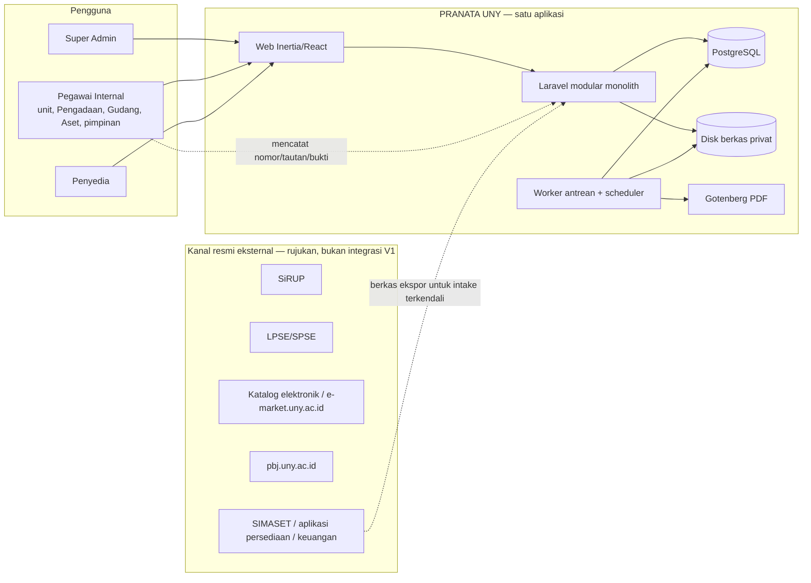

# Arsitektur aplikasi — PRANATA UNY

Status: P4 candidate — VERIFYING (AUTH-012), belum disetujui | Updated: 2026-10-30 (Asia/Jakarta) | Custodian: Planning Agent | Phase: P4

Dokumen ini memiliki **struktur aplikasi, katalog modul, aturan dependensi, pola lapisan dan komponen lintas modul**. Skema basis data dimiliki [DATA_MODEL](DATA_MODEL.md); kebijakan berversi dimiliki [POLICY_REGISTRY](POLICY_REGISTRY.md); generasi dokumen dimiliki [DOCUMENT_ENGINE](DOCUMENT_ENGINE.md); keamanan dimiliki P5 ([SECURITY_MODEL](../05-security/SECURITY_MODEL.md), [ACCESS_CONTROL](../05-security/ACCESS_CONTROL.md)); kontrak perintah, konkurensi dan performa dimiliki P6; topologi operasi dimiliki P9. Keputusan material berbentuk ADR berstatus **PROPOSED** di [docs/adr](../adr/README.md) dan baru berlaku setelah persetujuan Owner.

Arsitektur ini tidak menetapkan aturan pengadaan, akuntansi, organisasi atau kewenangan. Setiap aturan resmi yang masih OPEN (GAP-001–GAP-029) dipegang sebagai **data kebijakan berversi** yang baru berlaku setelah aktivasi berbukti, sehingga aplikasi dapat dibangun dan diuji tanpa mengarang aturan.

## 1. Ringkasan keputusan

| Area | Pilihan kandidat | ADR |
|---|---|---|
| Gaya arsitektur | Satu aplikasi **modular monolith** Laravel; modul domain dengan batas eksplisit; satu basis data PostgreSQL | [ADR-0001](../adr/ADR-0001-modular-monolith-stack.md) |
| Stack | Laravel (major stabil terkini saat bootstrap), PHP sesuai syarat Laravel tersebut, Inertia.js 2, React, TypeScript, Tailwind CSS 4, shadcn/ui, PostgreSQL (major yang didukung, minimal 16), Nginx | ADR-0001 |
| Konvensi data | Tabel berprefiks modul pada skema `public`; PK `bigint identity` + `public_id` ULID untuk akar agregat; `timestamptz` UTC; uang `numeric`; tanpa hard delete record bisnis | [ADR-0002](../adr/ADR-0002-data-conventions.md) |
| Aturan resmi yang berubah-ubah | **Policy Registry** berversi dengan aktivasi maker-checker dan label simulasi | [ADR-0003](../adr/ADR-0003-versioned-policy-registry.md) |
| Kebenaran stok dan aset | Ledger append-only + saldo/proyeksi yang diperbarui dalam transaksi yang sama dengan penguncian baris | [ADR-0004](../adr/ADR-0004-append-only-ledgers.md) |
| Dokumen | Template DOCX + pengisian terstruktur; PDF melalui Gotenberg self-hosted | [ADR-0005](../adr/ADR-0005-document-generation.md) |
| Antrean, cache, sesi | Driver basis data (tanpa Redis/Valkey pada V1) | [ADR-0006](../adr/ADR-0006-database-queue-no-redis.md) |
| Autentikasi | Lokal Laravel-native (username/email + password), pemulihan dibantu admin, SMTP opsional, TOTP untuk akun istimewa (keputusan Owner) | [ADR-0007](../adr/ADR-0007-local-authentication.md) |
| Pencarian | PostgreSQL `pg_trgm` + full-text; tanpa mesin pencari eksternal | [ADR-0008](../adr/ADR-0008-postgres-search.md) |
| Berkas | Disk privat lokal + checksum + unduhan terotorisasi; cadangan offsite | [ADR-0009](../adr/ADR-0009-private-file-storage.md) |
| Jejak audit | Tabel `audit_events` append-only berpartisi bulanan; peran DB aplikasi tanpa hak UPDATE/DELETE | [ADR-0010](../adr/ADR-0010-audit-and-db-roles.md) |

Semua pilihan memakai komponen gratis/open-source atau first-party Laravel; tidak ada biaya berulang baru selain infrastruktur yang dibiayai klien ([COST_POLICY](../00-governance/COST_POLICY.md)).

## 2. Konteks sistem



PRANATA tidak memanggil sistem eksternal pada V1 (BR-027, OD-12, GAP-029). Pengguna mencatat referensi (nomor RUP, kode tender, nomor pesanan, tautan) dan mengunggah bukti; data historis masuk lewat intake terkendali (WF-026). Integrasi masa depan memakai adapter di balik kontrak modul (bagian 9).

## 3. Struktur repositori aplikasi

```text
app/
  Modules/
    <Module>/
      Actions/            # use case perubahan (satu handle(), transaksi, audit, event)
      Queries/            # read model daftar/detail/pencarian dengan scope akses
      Models/             # Eloquent; perilaku domain sederhana; tabel berprefiks modul
      Enums/              # status, jenis, kode transisi (TR-xxx)
      Data/               # DTO masukan/keluaran (sumber tipe TypeScript)
      Policies/           # otorisasi objek (Laravel Policy)
      Rules/              # aturan domain/validasi yang dapat diuji terpisah
      Http/Controllers/   # tipis: otorisasi → validasi → Action/Query → respons Inertia
      Http/Requests/      # FormRequest
      Events/ Listeners/ Jobs/
      Contracts/          # API publik modul untuk modul lain
      Providers/          # service provider modul (route, policy, event, migration path)
      routes.php
      database/migrations/ database/factories/ database/seeders/
resources/js/
  pages/<module>/...      # halaman Inertia
  components/ui/          # komponen shadcn/ui (hasil generate, dikustomisasi token)
  components/app/         # komposit bersama (DataTable, NextActionCard, StatusBadge, ...)
  features/<module>/      # komponen dan hook khusus modul
  lib/                    # i18n, format angka/tanggal, helper rute, akses
  locales/{id,en}/        # katalog terjemahan UI
  types/                  # tipe hasil generate dari DTO
lang/{id,en}/             # pesan server (validasi, notifikasi, dokumen)
tests/{Unit,Feature,Arch}/  e2e/  perf/
```

Satu modul memiliki tabel, model, aksi, kebijakan dan halamannya sendiri. Struktur final mengikuti kerangka resmi Laravel React starter kit pada saat bootstrap aplikasi (TASK-002), dengan registrasi publik dimatikan.

## 4. Katalog modul

| Modul | Tanggung jawab | Data milik (prefiks) | Bergantung pada | CAP / WF utama |
|---|---|---|---|---|
| Platform | Kerangka aplikasi, pengaturan, gerbang aktivasi fitur, kesehatan sistem, lokal | `platform_` | — | CAP-20 |
| Identity | Akun, kredensial, sesi, pemulihan dibantu admin, TOTP, preferensi bahasa | `users`, `identity_` | Platform | CAP-01; WF-001 |
| Access | Kelompok peran, profil kapabilitas, grant bercakupan, penugasan proses, pemisahan tugas, evaluasi izin | `access_` | Identity, Organization, Policy | CAP-02; AC-02/04/31 |
| Organization | Unit organisasi hierarkis berversi, jabatan/fungsi resmi, penunjukan | `org_` | Platform | CAP-02; WF-029 F1/F2 |
| Reference | Data referensi/master: satuan, kategori barang, sumber dana, jenis pengadaan, lokasi | `ref_` | Organization | WF-029 F3 |
| Policy | Policy Registry: paket kebijakan berversi, aktivasi, evaluasi, label simulasi | `policy_` | Identity | CAP-23; WF-029 F4/F5/F8/F9 |
| Work | Item pekerjaan (pemilik, pihak ditunggu, tindakan berikut), inbox, notifikasi in-app | `work_` | Access | CAP-03; OD-19 |
| Workflow | Riwayat transisi generik bertanda kode TR P3; mesin transisi per modul | `workflow_` | Access, Audit | Semua WF |
| Numbering | Skema penomoran, alokasi, reservasi, pembatalan, anti-tabrakan | `numbering_` | Policy | OD-29; CAP-08 |
| Documents | Template berversi, generasi DOCX/PDF, versi dokumen, bukti tanda tangan, paket SPJ | `document_` | Files, Numbering, Policy | CAP-08; WF-028 |
| Files | Penyimpanan privat, checksum, metadata, tautan pemilik, unduhan terotorisasi | `file_` | Access | CAP-19 |
| Audit | Jejak audit append-only, pembacaan teraudit | `audit_` | Identity | CAP-19; IX-024 |
| Procurement | Kebutuhan, usulan, referensi RUP, paket, lingkup penghargaan, HPS, penetapan metode, pemilihan, aktivitas, undangan dan penjajakan, penawaran dan pembukaan, skema dan putaran evaluasi, klarifikasi, negosiasi, opsi katalog, hasil per lingkup dan reviu hasil, SPPBJ, kontrak, adendum, pelaksanaan, pemeriksaan/BAST, SPJ, permintaan dan pelacakan pembayaran, referensi anggaran | `proc_` | Organization, Reference, Policy, Documents, Numbering, Work, Vendor (kontrak) | CAP-04/05/06/08/09; WF-003–015/032/033 |
| Vendor | Perusahaan, PIC, akun penyedia, dokumen kualifikasi, status DPT, penilaian kinerja penyedia, partisipasi dan kiriman | `vendor_` | Identity, Files | CAP-07; WF-007/008 |
| Inventory | Gudang, barang, ledger stok, saldo, permintaan, serah terima, konfirmasi, pengembalian, opname, transfer | `inv_` | Organization, Reference, Policy, Work | CAP-14/21/22; WF-023/030/031 |
| Asset | Klasifikasi berversi, register aset, penempatan, kustodian, transaksi aset, kondisi, pemeliharaan, penghapusan, penyusutan, KDP | `asset_` | Organization, Reference, Policy | CAP-10–13/15; WF-016–022/024 |
| Reconciliation | Kasus rekonsiliasi, perbandingan, selisih, tindak lanjut | `recon_` | Inventory, Asset, Procurement (baca) | CAP-17; WF-025 |
| Intake | Batch impor, staging, validasi, isu, keputusan, penerimaan ke modul tujuan | `intake_` | Files, modul tujuan (kontrak) | CAP-16; WF-026 |
| Reporting | Definisi laporan, permintaan, ekspor asinkron (Filter-First), arsip keluaran | `report_` | Semua modul (Query kontrak) | CAP-13/17/18; WF-027 |
| Administration | Antarmuka Super Admin: pengguna, akses, organisasi, referensi, kebijakan, pemantauan | — (memakai modul lain) | Semua modul inti | OD-10 |

Handoff Procurement → Asset/Inventory (WF-016) berjalan melalui kontrak modul tujuan (`Asset\Contracts\CreatesAssetDraft`, `Inventory\Contracts\CreatesReceiptDraft`), bukan penulisan langsung ke tabel modul lain.

## 5. Aturan dependensi antar modul

1. Modul hanya menulis tabelnya sendiri. Penulisan lintas modul melalui `Contracts` modul pemilik atau event domain.
2. Pembacaan lintas modul memakai `Queries` publik atau kontrak; join lintas prefiks diperbolehkan hanya pada Query laporan di modul Reporting dan Reconciliation, dengan scope akses yang sama.
3. Arah dependensi: Platform ← Identity ← Access ← (Organization, Reference, Policy, Files, Audit, Numbering, Work, Workflow, Documents) ← (Vendor, Procurement, Inventory, Asset) ← (Reconciliation, Intake, Reporting) ← Administration. Siklus dilarang.
4. Event domain dikirim **setelah commit** (`afterCommit`) sehingga listener tidak pernah melihat data yang di-rollback.
5. Aturan ini diuji dengan Pest architecture tests (`tests/Arch`) pada setiap CI.

## 6. Pola lapisan

| Lapisan | Aturan |
|---|---|
| Route + Controller | Rute bernama per modul, middleware `auth` + gerbang aktivasi fitur; controller memanggil `authorize()`, FormRequest, lalu satu Action atau Query; tidak ada aturan bisnis di controller. |
| FormRequest | Validasi sintaks dan keberadaan; pesan dari `lang/{id,en}`; aturan bisnis yang bergantung keadaan ada di Action/Rules. |
| Action | Satu use case perubahan: membuka transaksi, mengunci baris yang diperlukan menurut urutan kunci P6, menjalankan guard transisi (TR), menulis data + `workflow_transitions` + `audit_events`, memperbarui item pekerjaan, mengirim event after-commit. Idempotensi mengikuti [COMMAND_AND_API_CONTRACTS](../06-api-performance/COMMAND_AND_API_CONTRACTS.md). |
| Query | Daftar/detail/pencarian dengan scope akses wajib (`visibleTo($actor)`), pagination keyset untuk tabel besar, kolom/sort/filter whitelist. |
| Policy | Otorisasi objek: kelompok peran → kapabilitas pada cakupan → penugasan proses → pemisahan tugas → guard keadaan ([ACCESS_CONTROL](../05-security/ACCESS_CONTROL.md)). |
| Model | Eloquent dengan `$table` eksplisit berprefiks, cast enum/decimal, tanpa logika lintas modul; `preventLazyLoading` aktif di luar produksi. |
| Halaman React | Menerima props bertipe; aksi tampil hanya bila server mengirim izin `can.*` untuk objek itu; tidak ada penegakan yang hanya di frontend (OD-33). |

Mesin transisi: setiap workflow P3 diimplementasikan sebagai peta transisi eksplisit di modul pemiliknya (`Enums/<Workflow>State`, `Enums/<Workflow>Transition`), dengan kode TR P3 sebagai identitas transisi. TR berstatus BLOCKED_BY_GAP hanya dapat dijalankan bila kebijakan yang menjadi gerbangnya ACTIVE (bagian 8.1).

## 7. Komponen lintas modul

| Komponen | Kontrak inti |
|---|---|
| Policy Registry | Lihat [POLICY_REGISTRY](POLICY_REGISTRY.md): keluarga kebijakan, versi DRAFT→IN_REVIEW→ACTIVE→SUPERSEDED/RETIRED, aktivasi maker-checker berbukti, resolusi menurut rezim/tanggal/cakupan, label simulasi. |
| Item pekerjaan | `work_items` dipelihara Action modul: subjek, jenis, penanggung jawab (user atau fungsi/penugasan), pihak ditunggu, tindakan berikut, bukti yang kurang, tenggat hanya bila tervalidasi. Inbox, dashboard dan kartu Next-Action membaca tabel ini. |
| Penomoran | Skema per jenis dokumen/unit/tahun dari kebijakan; saran nomor dialokasikan dengan kunci baris; konfirmasi/override oleh petugas berwenang; unik per skema; status RESERVED/USED/VOIDED; tidak pernah bertabrakan diam-diam (OD-29). |
| Dokumen | Lihat [DOCUMENT_ENGINE](DOCUMENT_ENGINE.md): snapshot data → template DOCX berversi → DOCX/PDF; tanda air DRAF/SIMULASI; versi; bukti tanda tangan; paket SPJ. |
| Berkas | Disk privat di luar webroot; SHA-256; validasi MIME/ekstensi/ukuran; unduhan via controller terotorisasi dengan `Content-Disposition: attachment`; berkas rahasia teraudit. |
| Audit | `audit_events` untuk setiap perubahan material, keputusan, aktivasi kebijakan, perubahan akses, pembacaan rahasia (IX-024) dan login/keamanan. |
| Pencarian | Penyedia pencarian per modul (`SearchProvider`) yang menerapkan scope akses; pencarian global menggabungkan hasil per modul; indeks `pg_trgm`/`tsvector`. |
| Laporan & ekspor | Permintaan laporan disimpan, dijalankan di antrean `exports`, ditulis streaming (OpenSpout) ke berkas privat; isi ekspor = filter yang terlihat (Filter-First); label simulasi bila bergantung kebijakan non-ACTIVE. |
| Intake | Berkas sumber → staging `intake_rows` → validasi struktur/makna → isu → keputusan → penerimaan melalui kontrak modul tujuan; tidak ada impor langsung ke tabel final. |
| Antrean & jadwal | Driver database; antrean `default`, `documents`, `exports`, `imports`, `maintenance`; worker dikelola supervisor/systemd; scheduler untuk partisi audit, pembersihan idempotensi, pengingat, cadangan terverifikasi. |
| Lokalisasi | UI `id-ID` default dan `en`; dokumen resmi berbahasa Indonesia apa pun bahasa UI; format angka/tanggal Indonesia; detail di [LOCALIZATION](../07-ux-design/LOCALIZATION.md). |
| Gerbang aktivasi fitur | Setiap kapabilitas yang bergantung pada kebijakan memeriksa status kebijakan. Di produksi, aksi resmi tanpa versi ACTIVE tidak tersedia dan dijelaskan alasannya; perhitungan saran boleh tampil berlabel simulasi. |

## 8. Keputusan perilaku penting

### 8.1 OPEN GAP sebagai gerbang aktivasi

Model ini adalah usulan perencanaan atas pernyataan GAP_REGISTER yang disetujui bahwa GAP menghalangi spesifikasi/Task yang bergantung; konfirmasinya, beserta daftar GAP yang wajib selesai sebelum go-live, menunggu keputusan Owner D-28 ([OWNER_DECISION_PACKAGE](../handoff/OWNER_DECISION_PACKAGE.md)).

| Situasi | Lingkungan non-produksi (dev/CI/staging/UAT) | Produksi |
|---|---|---|
| Kebijakan ACTIVE | Normal | Normal |
| Hanya DRAFT/IN_REVIEW | Dapat dipakai bila `PRANATA_ALLOW_DRAFT_POLICIES=true`; semua keluaran dan dokumen bertanda SIMULASI | Aksi resmi yang bergantung tidak tersedia ("Menunggu pengesahan kebijakan"); perhitungan saran/pratinjau boleh tampil berlabel SIMULASI tanpa menghasilkan record resmi |
| Tidak ada kebijakan | Aksi tidak tersedia, alasan + GAP ditampilkan | Sama |

### 8.2 Pemisahan klaim

Pemilihan penyedia, administrasi internal, penyiapan dokumen, penerbitan/tanda tangan, penerimaan/BAST, pembayaran, pengakuan aset, stok fisik dan penyusutan disimpan sebagai record dan status berbeda (BR-032). Tidak ada trigger lintas modul yang membuat klaim hilir otomatis; handoff membuat **draf** di modul tujuan (WF-016).

### 8.3 Skala

Desain mengasumsikan sekitar 200 pengguna dan 1.000.000 aset (OD-16/22/32): semua daftar besar memakai pagination keyset di server, indeks sesuai pola filter, ekspor/impor/penyusutan sebagai job berlatar, tidak ada pemrosesan seluruh data di browser. Anggaran performa dimiliki [PERFORMANCE_AND_SCALE](../06-api-performance/PERFORMANCE_AND_SCALE.md).

## 9. Batas integrasi

V1 tidak memiliki integrasi keluar. Untuk masa depan (SSO/LDAP, SiRUP, SPSE/LPSE, SIMASET, keuangan, kepegawaian, email institusi, tanda tangan digital, penyimpanan objek), modul pemilik mendefinisikan `Contracts` yang sudah dipakai oleh implementasi lokal V1 (misalnya `ReferenceCapture` untuk nomor eksternal, `SignatureEvidence` untuk bukti tanda tangan pindaian). Adapter eksternal kelak mengimplementasikan kontrak yang sama tanpa mengubah aturan domain. Tidak ada SDK vendor di inti domain; abstraksi baru hanya dibuat bila variasinya nyata (AICWDF §15.1.8).

| Kemampuan | V1 | Titik ekstensi |
|---|---|---|
| Kanal pengadaan resmi | Referensi manual + bukti | `Procurement\Contracts\ExternalChannelReference` |
| Tanda tangan | Pindaian/berkas bertanda tangan + metadata | `Documents\Contracts\SignatureEvidence` |
| Email | SMTP opsional melalui konfigurasi Laravel Mail; tanpa SMTP semua notifikasi tetap in-app | Driver mail |
| Penyimpanan berkas | Disk lokal privat | Disk S3-kompatibel lewat Flysystem |
| Identitas institusi | Akun lokal | Guard/driver autentikasi tambahan |

## 10. Pandangan penerapan (ringkas)

Satu server produksi (VPS/server yang dibiayai klien) menjalankan Nginx, PHP-FPM, worker antrean, scheduler, PostgreSQL dan Gotenberg, dengan cadangan PITR dan salinan offsite. Lingkungan staging terpisah dan data sintetis/teranonimkan. Detail, batas sumber daya, isolasi dari proyek lain di mesin pengembang dan prosedur operasi dimiliki [INFRASTRUCTURE](../09-operations/INFRASTRUCTURE.md).

## 11. Atribut kualitas

| Atribut | Strategi | Pemilik detail |
|---|---|---|
| Kebenaran data | Constraint DB, ledger append-only, penguncian baris, idempotensi, transisi bertanda TR | DATA_MODEL, P6 |
| Keamanan | Otorisasi berlapis server/kueri/unduhan, peran DB terpisah, audit, header keamanan | P5 |
| Ketersediaan & pemulihan | PITR WAL, salinan offsite, uji restore; RTO 4 jam / RPO 1 jam sebagai target desain | P9/P10 |
| Performa | Indeks terarah, keyset, job berlatar, anggaran p95 | P6 |
| Pemeliharaan | Modul eksplisit, arch tests, ADR, kebijakan sebagai data | P4/P8 |
| Kegunaan & aksesibilitas | Next-Action, input sekali, WCAG 2.2 AA sebagai target | P7 |
| Biaya | Komponen open-source/first-party, self-hosted | COST_POLICY, P9 |

## 12. Risiko arsitektur

| Risiko | Mitigasi |
|---|---|
| Kebijakan resmi tidak kunjung divalidasi sehingga fitur tidak dapat aktif di produksi | Paket resolusi GAP ([OWNER_DECISION_PACKAGE](../handoff/OWNER_DECISION_PACKAGE.md)); kebijakan sebagai data sehingga jawaban tidak memerlukan pengembangan ulang |
| Kompleksitas lima metode × dua rezim × empat jenis pengadaan | Satu kerangka paket + ekstensi metode yang dikendalikan kebijakan; pengujian matriks dengan data sintetis |
| Driver database untuk antrean menjadi bottleneck | Beban diperkirakan rendah; antrean terpisah per jenis; pemantauan Pulse; ADR-0006 mencatat kriteria pindah ke Redis/Valkey |
| Ketergantungan Gotenberg untuk PDF | Kontainer lokal; DOCX tetap dapat diunduh bila PDF gagal; health check |
| Versi framework berubah sebelum eksekusi | TASK-002 memverifikasi versi terkini via dokumentasi resmi dan mencatatnya di TOOLCHAIN |

## 13. Verifikasi yang ditunda ke eksekusi

Versi pasti Laravel/PHP/Inertia/React/Tailwind/shadcn/PostgreSQL, perilaku starter kit (helper rute, fitur 2FA bawaan), dan kompatibilitas paket pihak ketiga diverifikasi dari dokumentasi resmi saat TASK-002 (aplikasi) dan TASK-003 (lingkungan) dan dicatat di [TOOLCHAIN](../00-governance/TOOLCHAIN.md). Bila ada ketidakcocokan dengan dokumen ini, eksekutor berhenti dan mengajukan TASK PLAN CHANGE, bukan menyimpang diam-diam.
