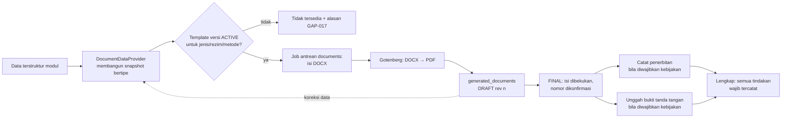

# Mesin dokumen — generasi, versi, nomor dan bukti tanda tangan

Status: P4 candidate — VERIFYING (AUTH-012), belum disetujui | Updated: 2026-10-30 (Asia/Jakarta) | Custodian: Planning Agent | Phase: P4 | ADR: [ADR-0005](../adr/ADR-0005-document-generation.md)

Dokumen ini memiliki desain teknis WF-028 dan OD-08/OD-29: data dimasukkan sekali, dokumen terkait dihasilkan dalam beberapa klik, setiap keluaran dapat dijelaskan asal datanya, dan dokumen resmi berbahasa Indonesia. Varian dokumen, isi wajib dan penomoran resmi tetap kebijakan (GAP-017/019) yang dikelola Policy Registry.

## 1. Alur

| Langkah | Kontrak |
|---|---|
| Snapshot | Setiap jenis dokumen memiliki `DocumentDataProvider` di modul pemilik yang menghasilkan DTO bertipe → `data_snapshot` + `data_sha256`. Dokumen tidak membaca basis data setelah snapshot dibuat; regenerasi selalu memakai snapshot baru. |
| Template | DOCX dengan placeholder `${nama}`, baris berulang (`cloneRow`) dan blok (`cloneBlock`) gaya PhpWord TemplateProcessor. Saat unggah, placeholder dipindai dan dicocokkan dengan `placeholder_schema` provider: placeholder wajib hilang atau tak dikenal → template ditolak. |
| Banner status | Setiap template wajib memuat `${status_banner}` pada header. Nilainya `DRAF — BUKAN DOKUMEN RESMI` untuk DRAFT dan `SIMULASI — KEBIJAKAN BELUM DISAHKAN` bila `is_simulation`; kosong hanya untuk dokumen FINAL non-simulasi. |
| Konversi | Job antrean `documents` mengirim DOCX ke Gotenberg (route LibreOffice) dengan batas waktu; bila PDF gagal, DOCX tetap tersedia dan status konversi menunjukkan kegagalan yang dapat diulang (EP-010). |
| Nomor | Saat finalisasi, layanan Numbering memberi saran nomor sesuai skema kebijakan; petugas berwenang mengonfirmasi atau mengisi manual; keunikan dijamin constraint (OD-29). Tanpa skema ACTIVE, finalisasi resmi tidak tersedia. |
| Revisi | Koreksi menghasilkan revisi baru; revisi lama menjadi SUPERSEDED dan tetap dapat dibuka. Dokumen FINAL — termasuk yang sudah diterbitkan atau ditandatangani — tidak pernah ditimpa; pembatalan memerlukan alasan (VOIDED). Perlakuan nomor pada revisi mengikuti kebijakan (GAP-017). |
| Penerbitan dan tanda tangan | Tindakan terpisah atas dokumen FINAL. Wajib/tidaknya dan urutannya per jenis dokumen berasal dari kebijakan `procurement.documents`; tanpa urutan dari kebijakan, keduanya independen dan dapat dicatat dalam urutan apa pun (STATE_TRANSITIONS WF-028 TR-274 dan WF-011 TR-102–104 tidak menetapkan urutan). Status tampilan diturunkan dari tindakan yang tercatat. |
| Bukti tanda tangan | V1 mencatat bukti tanda tangan basah (pindaian) atau PDF bertanda tangan yang diunggah, beserta snapshot nama/jabatan penanda tangan dari penunjukan. Tanda tangan digital adalah ekstensi masa depan (`SignatureEvidence`). |
| Paket SPJ | `document_packs` menyusun daftar persyaratan dari kebijakan `procurement.documents`, menandai yang ada/kurang, dan dapat dirakit menjadi satu PDF gabungan (Gotenberg merge) beserta lembar indeks, atau ZIP. |

## 2. Format bahasa Indonesia

| Unsur | Aturan |
|---|---|
| Uang | `Rp1.234.567,00` (pemisah ribuan titik, desimal koma); jumlah terbilang bahasa Indonesia ("satu juta dua ratus tiga puluh empat ribu lima ratus enam puluh tujuh rupiah") dari fungsi terbilang yang diuji tabel |
| Tanggal | `30 Oktober 2026`; nama hari Indonesia bila diminta template; zona Asia/Jakarta |
| Angka kuantitas | Pemisah ribuan titik; desimal koma; jumlah desimal mengikuti satuan |
| Bahasa | Dokumen resmi selalu bahasa Indonesia, tidak mengikuti bahasa UI pengguna |

## 3. Katalog jenis dokumen awal

Katalog ini adalah daftar jenis yang perlu didukung mesin; varian, isi wajib dan penerapannya per metode tetap kebijakan.

| Kelompok | Jenis dokumen (kode) | Sumber data |
|---|---|---|
| Pengadaan — persiapan | Kerangka acuan/spesifikasi (`PROC_SPEC`), rincian HPS (`PROC_HPS`), nota penetapan metode (`PROC_METHOD_NOTE`) | Paket, HPS, penetapan |
| Pengadaan — pemilihan | Undangan (`PROC_INVITATION`), BA penjelasan (`PROC_BA_EXPLANATION`), BA pembukaan (`PROC_BA_OPENING`), BA evaluasi (`PROC_BA_EVALUATION`), BA klarifikasi/negosiasi (`PROC_BA_NEGOTIATION`), BA hasil pengadaan langsung (`PROC_BA_PL_RESULT`), laporan hasil pemilihan (`PROC_SELECTION_REPORT`), surat penetapan pemenang (`PROC_WINNER_LETTER`) | Aktivitas, partisipasi, evaluasi, hasil |
| Pengadaan — kontrak | SPPBJ/surat penunjukan penyedia (`PROC_SPPBJ`), SPK (`PROC_SPK`), surat perjanjian/kontrak (`PROC_CONTRACT`), surat pesanan (`PROC_ORDER`), adendum (`PROC_AMENDMENT`) | Hasil, kontrak, adendum |
| Pengadaan — pelaksanaan | BA pemeriksaan (`PROC_BA_INSPECTION`), BAST (`PROC_BAST`), PHO/FHO (`PROC_PHO`, `PROC_FHO`), lembar kelengkapan SPJ (`PROC_SPJ_INDEX`) | Pemeriksaan, serah terima, paket SPJ |
| Gudang | Bukti serah terima barang (`INV_HANDOVER_RECEIPT`), tanda terima pengembalian (`INV_RETURN_RECEIPT`), BA hitung fisik (`INV_COUNT_REPORT`) | Serah terima, pengembalian, opname |
| Aset | BA mutasi (`ASSET_MUTATION`), daftar inventarisasi (`ASSET_VERIFICATION_LIST`), usulan penghapusan (`ASSET_DISPOSAL_PROPOSAL`) | Mutasi, verifikasi, penghapusan |

Template awal disusun sebagai versi **DRAFT** dari struktur generik yang teramati pada sumber (tanpa nama, nomor atau nilai historis) dan diganti/disahkan dengan template resmi yang diunggah petugas berwenang (GAP-017).

## 4. Keamanan dan privasi

Dokumen mewarisi otorisasi subjeknya; unduhan melalui controller terotorisasi (ACCESS_CONTROL). Dokumen berisi penawaran penyedia berklasifikasi CONFIDENTIAL; akses Super Admin hanya lewat IX-024. Snapshot tidak menyimpan rahasia (password, token). Berkas disimpan di disk privat dengan SHA-256.

## 5. Performa dan keandalan

Generasi dan konversi berjalan di antrean `documents` dengan concurrency terbatas (default 2 worker) agar tidak membebani server; UI menampilkan status operasi (EP-010) dan memperbarui otomatis. Target: dokumen 1–10 halaman siap ≤ 10 detik p95 pada beban normal (diverifikasi P8). Gotenberg dipantau health check; kegagalan berulang memicu peringatan operasi.

## 6. Pengujian

- Uji provider: snapshot sesuai DTO dan konsisten dengan data sumber.
- Uji template emas: DOCX hasil dibuka, `word/document.xml` tidak memuat `${`, nilai terformat benar, baris berulang lengkap.
- Uji terbilang dan format angka/tanggal berbasis tabel.
- Uji integrasi Gotenberg di CI penuh (service container) dan uji gagal-konversi.
- Uji banner DRAF/SIMULASI, nomor unik, revisi/supersession dan otorisasi unduhan.
