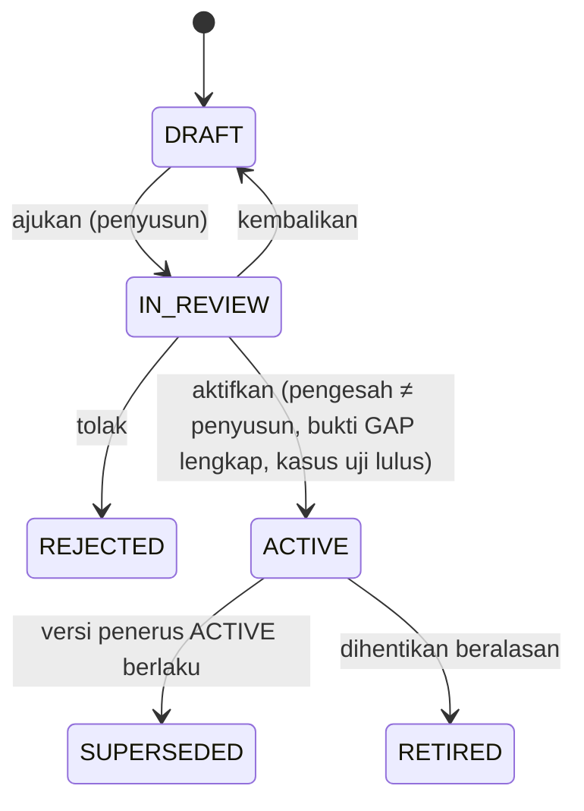

# Policy Registry — aturan resmi sebagai data berversi

Status: P4 candidate — VERIFYING (AUTH-012), belum disetujui | Updated: 2026-10-30 (Asia/Jakarta) | Custodian: Planning Agent | Phase: P4 | ADR: [ADR-0003](../adr/ADR-0003-versioned-policy-registry.md)

Policy Registry adalah mekanisme agar PRANATA dapat dibangun lengkap **tanpa mengarang aturan resmi**. Setiap nilai yang bergantung pada instrumen institusi atau regulasi — ambang metode, pejabat penetap, varian dokumen, penomoran, rantai persetujuan gudang, ambang kapitalisasi, metode penyusutan, kode transaksi — disimpan sebagai **versi kebijakan** dengan rujukan sumber, rujukan GAP dan status. Kode aplikasi hanya mengetahui *struktur* aturan (skema JSON per keluarga) dan cara mengevaluasinya. Ini mewujudkan CAP-23, BR-031 dan INV-022.

## 1. Keluarga kebijakan

| Keluarga (`family`) | Isi | Paket contoh (`key`) | GAP gerbang | Konsumen |
|---|---|---|---|---|
| `procurement.regime` | Pemetaan sumber dana + tanggal → rezim; daftar rezim | `procurement.regime.uny` | GAP-026 | WF-032 |
| `procurement.methods` | Per rezim: metode, pita nilai per jenis pengadaan, kriteria kualitatif, syarat DPT, kanal resmi, penanda tumpang tindih | `procurement.methods.pr34-2023`, `procurement.methods.perpres16-2018-46-2025` | GAP-026/027/029 | WF-032, WF-005 |
| `procurement.authority` | Fungsi penetap metode, penyusun/penetap HPS, penetap pemenang menurut nilai, empat tanggung jawab SPPBJ, penanda tangan per dokumen | `procurement.authority.pr34-2023` | GAP-003/004/014 | WF-005–015/032 |
| `procurement.documents` | Varian dokumen per rezim/metode/jenis, dokumen wajib per langkah, kelengkapan SPJ, pemetaan template | `procurement.documents.pr34-2023` | GAP-017/019 | WF-011–015/028 |
| `procurement.contract` | Bentuk bukti perjanjian menurut nilai, jaminan, batas adendum dan pemberi pengecualian, denda keterlambatan, skema pembayaran | `procurement.contract.pr34-2023` | GAP-026/027 | WF-012/013/033 |
| `procurement.hps` | Kewajiban/pengecualian HPS, pajak, pembulatan, komponen konsultansi | `procurement.hps.pr34-2023` | GAP-019/027 | HPS |
| `procurement.budget` | Sumber rujukan anggaran, aturan komitmen dan pelepasan | `procurement.budget.uny` | GAP-028 | BR-035 |
| `vendor.dpt` | Katalog dokumen pendaftaran, langkah verifikasi, masa berlaku, evaluasi, pengeluaran | `vendor.dpt.pr34-2023` | GAP-026 | WF-007/008 |
| `warehouse.operations` | Per gudang: jenis permintaan, rantai keputusan, bentuk bukti serah terima/konfirmasi, aturan penutupan, kriteria pemeriksaan pengembalian, kewenangan transfer/penyesuaian | `warehouse.operations.alp`, `warehouse.operations.psrt` | GAP-025/023 | WF-023/030/031 |
| `inventory.codes` | Kamus kode transaksi institusi dan pemetaan kode historis | `inventory.codes.uny` | GAP-005/006 | WF-023/026, laporan |
| `asset.capitalization` | Ambang kapitalisasi, aturan tanggal pengakuan | `asset.capitalization.uny` | GAP-008/009 | WF-016/017 |
| `asset.depreciation` | Metode, masa manfaat per klasifikasi, awal penyusutan, pembulatan, cutoff | `asset.depreciation.uny` | GAP-007 | WF-022/027 |
| `asset.classification` | Pemetaan klasifikasi ke akun/kategori laporan | `asset.classification.uny` | GAP-022 | WF-029 F6, laporan |
| `asset.lifecycle` | Rantai keputusan mutasi, koreksi, pengembangan, reklasifikasi, penghapusan | `asset.lifecycle.uny` | GAP-008/013/014 | WF-018–021 |
| `reconciliation` | Jenis kasus, pemilik, penerima hasil, periode | `reconciliation.uny` | GAP-010/012 | WF-025 |
| `organization.maintenance` | Kewenangan pemeliharaan per keluarga F1–F9 | `organization.maintenance.uny` | GAP-021 | WF-029 |
| `numbering` | Skema nomor per jenis dokumen | `numbering.uny` | GAP-017 | Numbering |
| `reporting.formats` | Format laporan resmi (termasuk BMU) | `reporting.formats.uny` | GAP-007–010/013 | WF-027 |
| `retention` | Jadwal retensi/arsip/anonimisasi | `retention.uny` | GAP-023 | P9/P10 (kelak) |

Daftar ini dapat bertambah melalui TASK PLAN CHANGE; setiap keluarga baru memerlukan skema JSON, evaluator dan kasus uji.

## 2. Lifecycle versi



| Aturan | Isi |
|---|---|
| Maker-checker | Pengesah tidak boleh sama dengan pembuat atau pengaju (constraint DB + pemeriksaan aplikasi). Keduanya memerlukan kapabilitas berbeda: `policy.author` dan `policy.activate` untuk keluarga terkait. |
| Bukti | Status ACTIVE mensyaratkan `resolution_evidence` untuk setiap `gap_refs`: rujukan keputusan resmi (nomor/tanggal instrumen, keputusan Owner yang tercatat di repositori) dan berkas bukti. |
| Kasus uji | Semua `policy_test_cases` paket harus lulus terhadap versi kandidat sebelum aktivasi; hasil disimpan di audit. |
| Tanggal berlaku | `effective_from` wajib; tidak ada dua versi ACTIVE yang tumpang tindih (EXCLUDE constraint). Versi baru tidak mengubah record lama yang sudah merujuk versi lama (INV-017/018). |
| Imutabilitas | `content` tidak dapat diubah setelah IN_REVIEW; perubahan berarti versi baru. |
| Audit | Setiap perubahan status tercatat di `audit_events` dan `workflow_transitions` (keluarga WF-029 F4). |

### 2.1 Hubungan dengan GAP_REGISTER

Aktivasi di aplikasi **tidak** menutup GAP di repositori dan sebaliknya penutupan GAP tidak otomatis mengaktifkan kebijakan. Urutan yang aman:

1. Owner memperoleh jawaban resmi dari pemegang kewenangan (paket pertanyaan di [OWNER_DECISION_PACKAGE](../handoff/OWNER_DECISION_PACKAGE.md)).
2. Jawaban dicatat di repositori melalui disiplin GAP (sumber/tanggal/versi, keputusan Owner, review independen) sehingga status GAP menjadi RESOLVED.
3. Pengelola kebijakan menyusun versi yang isinya sesuai jawaban, dengan rujukan keputusan repositori.
4. Pengesah yang berbeda memeriksa dan mengaktifkan dengan bukti.

## 3. Resolusi dan evaluasi

```text
PolicyResolver::resolve(family, context) -> PolicyHandle
  context: { regime_key?, warehouse_code?, org_unit_id?, reference_date, allow_simulation }
  1. pilih paket menurut family + context (mis. regime_key, warehouse_code)
  2. pilih versi ACTIVE yang berlaku pada reference_date
  3. bila tidak ada dan allow_simulation dan lingkungan mengizinkan DRAFT:
       pilih versi DRAFT/IN_REVIEW terbaru -> is_simulation = true
  4. bila tidak ada: PolicyUnavailable(family, gap_refs) -> aksi tidak tersedia + alasan
PolicyHandle: { version_id, status, is_simulation, content, citations }
```

Setiap evaluator mengembalikan `PolicyOutcome { value, citations[], policy_version_id, is_simulation }`; Action yang menyimpan hasil wajib menyimpan `policy_version_id` dan `is_simulation`. Aturan lingkungan:

| Konfigurasi | Default produksi | Default non-produksi |
|---|---|---|
| `PRANATA_ALLOW_DRAFT_POLICIES` | `false` | `true` |
| Aksi resmi dengan kebijakan non-ACTIVE | Tidak tersedia | Tersedia, bertanda simulasi |
| Perhitungan saran/pratinjau dengan kebijakan non-ACTIVE | Tampil berlabel "Simulasi — kebijakan belum disahkan", tanpa record resmi | Sama |

## 4. Contoh isi: `procurement.methods.pr34-2023` (DRAFT)

Contoh di bawah memperlihatkan bentuk data; nilainya disalin dari PR 34/2023 sebagai **DRAFT** dengan rujukan dan tetap memerlukan konfirmasi kustodian (GAP-026/027) sebelum ACTIVE. Rincian sumber: [REGULATORY_SOURCE_REVIEW](../00-governance/evidence/REGULATORY_SOURCE_REVIEW.md).

```json
{
  "regime_key": "PR34_2023",
  "type_labels": { "OTHER_SERVICES": "Jasa Non Konsultansi" },
  "methods": [
    { "code": "PL",
      "bands": [
        { "types": ["GOODS","CONSTRUCTION","OTHER_SERVICES"], "max": "700000000.00", "inclusive_max": true, "cite": "Pasal 25 ayat (1) huruf a" },
        { "types": ["CONSULTING"], "max": "300000000.00", "inclusive_max": true, "cite": "Pasal 25 ayat (1) huruf b" } ],
      "qualitative_any": ["STANDARD_GOODS","LOW_RISK","MARKET_AVAILABLE","DAILY_OPERATIONAL"],
      "qualitative_cite": "Pasal 25 ayat (1) huruf c–f",
      "requires_dpt": false },
    { "code": "QUOTATION",
      "bands": [
        { "types": ["GOODS","CONSTRUCTION","OTHER_SERVICES"], "min_exclusive": "700000000.00", "max": "2000000000.00", "cite": "Pasal 26 ayat (1) huruf a" },
        { "types": ["CONSULTING"], "min_exclusive": "300000000.00", "max": "400000000.00", "cite": "Pasal 26 ayat (1) huruf b" } ],
      "qualitative_any": ["LOW_RISK_HIGH_COST","HIGH_RISK_MEDIUM_COST_FEW_PROVIDERS"],
      "requires_dpt": true, "min_invited": 3, "channel": "PBJ_UNY", "cite_channel": "Lampiran III B" },
    { "code": "TENDER",
      "bands": [
        { "types": ["GOODS","CONSTRUCTION","OTHER_SERVICES"], "min_exclusive": "2000000000.00", "cite": "Pasal 27 ayat (1) huruf a" },
        { "types": ["CONSULTING"], "min_exclusive": "300000000.00", "cite": "Pasal 27 ayat (1) huruf b" } ],
      "qualitative_any": ["COMPLEX_HIGH_TECH","NEW_WORK_TYPE"],
      "requires_dpt": true, "variants": ["OPEN","LIMITED","TWO_STAGE"] },
    { "code": "PENUNJUKAN_LANGSUNG", "criteria_only": true, "criteria_ref": "Pasal 28 (keadaan tertentu a–o; kriteria khusus a–g)", "requires_dpt": true },
    { "code": "E_PURCHASING", "catalog_only": true, "max": "15000000000.00", "channel": "E_MARKET_UNY", "cite": "Pasal 29; Lampiran III E angka 7" }
  ],
  "overlaps": [ { "types": ["CONSULTING"], "range": ["300000000.00","400000000.00"], "methods": ["QUOTATION","TENDER"], "gap": "GAP-027(a)", "requires_human_choice": true } ]
}
```

Kasus uji minimal paket ini: barang Rp700.000.000 → PL memenuhi; barang Rp700.000.001 → Quotation memenuhi, PL tidak; konsultansi Rp350.000.000 → Quotation dan Tender memenuhi dengan penanda tumpang tindih wajib-pilih; barang Rp2.000.000.001 → Tender; E-Purchasing hanya bila barang tercantum di katalog dan ≤ Rp15.000.000.000.

## 5. Contoh isi lain (bentuk, bukan nilai resmi)

| Paket | Bentuk isi |
|---|---|
| `warehouse.operations.alp` | `request_types[{code, label, approval_chain:[{step, assignment_role, scope}]}]`, `handover_evidence:{recipient_without_account: "SIGNED_RECEIPT_UPLOAD"}`, `confirmation:{close_without_confirmation_after_working_days: null}`, `return_inspection:{criteria:[…], inspector_role}`, `transfer:{approver_role}`, `count_adjustment:{approver_role}` |
| `asset.capitalization.uny` | `threshold:{amount, comparison:"GREATER_THAN"}`, `recognition_date_rule:"PAYMENT_DOCUMENT_DATE"`, `donation_rule:…` — nilai provisional Owner (Rp8.000.000) tercatat sebagai masukan SRC-052, bukan nilai ACTIVE |
| `asset.depreciation.uny` | `method:"STRAIGHT_LINE"`, `start_rule:"MONTH_AFTER_RECOGNITION"`, `useful_life_months_by_classification:{…}`, `rounding:{scale:2, mode:"HALF_UP"}`, `cutoff:{…}` |
| `procurement.authority.pr34-2023` | `method_determiner_roles`, `hps_setter_role`, `winner_setter:[{min_exclusive, role}]`, `sppbj:{preparer, checker, issuer, signer}`, `sod:[{a:"PPK", b:"POKJA_MEMBER", scope:"PACKAGE"}, …]` |

## 6. Antarmuka pengelolaan

Konteks RT-032 (Administrasi → Kebijakan): daftar paket per keluarga dengan versi ACTIVE dan DRAFT, editor isi berbasis formulir yang dibangkitkan dari skema JSON (bukan editor JSON bebas untuk pengguna non-teknis), panel rujukan sumber dan GAP, unggah bukti, hasil kasus uji, perbandingan versi (diff), riwayat dan tombol aktivasi yang hanya muncul bagi pengesah yang berhak. Detail halaman di [INFORMATION_ARCHITECTURE](../07-ux-design/INFORMATION_ARCHITECTURE.md).

## 7. Pengujian

- Validasi skema untuk setiap keluarga (isi tidak valid tidak dapat disimpan).
- Evaluator diuji dengan kasus uji tabel (golden cases) termasuk batas inklusif/eksklusif dan tumpang tindih.
- Uji maker-checker (pembuat tidak dapat mengaktifkan), EXCLUDE tumpang tindih, dan penolakan aksi resmi di produksi tanpa ACTIVE.
- Uji bahwa record lama tetap merujuk versi lamanya setelah versi baru aktif.
- Uji label simulasi pada layar, ekspor dan dokumen (AC-32).
