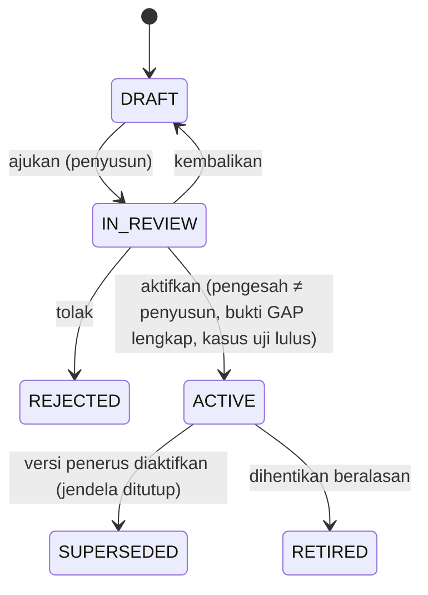

# Policy Registry — aturan resmi sebagai data berversi

Status: P4 — APPROVED (APPR-006); baseline beku FRZ-001 | Updated: 2026-11-01 (Asia/Jakarta) | Custodian: Planning Agent | Phase: P4 | ADR: [ADR-0003](../adr/ADR-0003-versioned-policy-registry.md)

Policy Registry adalah mekanisme agar PRANATA dapat dibangun lengkap **tanpa mengarang aturan resmi**. Setiap nilai yang bergantung pada instrumen institusi atau regulasi — ambang metode, pejabat penetap, varian dokumen, penomoran, rantai persetujuan gudang, ambang kapitalisasi, metode penyusutan, kode transaksi — disimpan sebagai **versi kebijakan** dengan rujukan sumber, rujukan GAP dan status. Kode aplikasi hanya mengetahui *struktur* aturan (skema JSON per keluarga) dan cara mengevaluasinya. Ini mewujudkan CAP-23, BR-031 dan INV-022.

## 1. Keluarga kebijakan

| Keluarga (`family`) | Isi | Paket contoh (`key`) | GAP gerbang | Konsumen |
|---|---|---|---|---|
| `procurement.regime` | Pemetaan sumber dana + tanggal → rezim; daftar rezim | `procurement.regime.uny` | GAP-026 | WF-032 |
| `procurement.methods` | Per rezim: metode, pita nilai per jenis pengadaan, kriteria kualitatif, syarat DPT, kanal resmi, penanda tumpang tindih | `procurement.methods.pr34-2023`, `procurement.methods.perpres16-2018-46-2025` | GAP-026/027/029 | WF-032, WF-005 |
| `procurement.authority` | Fungsi penetap metode, penyusun/penetap HPS, penetap pemenang menurut nilai, empat tanggung jawab SPPBJ, penanda tangan per dokumen | `procurement.authority.pr34-2023` | GAP-003/004/014 | WF-005–015/032 |
| `procurement.documents` | Varian dokumen per rezim/metode/jenis, dokumen wajib per langkah, kelengkapan SPJ, pemetaan template | `procurement.documents.pr34-2023` | GAP-017/019 | WF-011–015/028 |
| `procurement.contract` | Bentuk bukti perjanjian menurut nilai, jaminan, batas adendum dan pemberi pengecualian, denda keterlambatan, skema pembayaran | `procurement.contract.pr34-2023` | GAP-026/027 | WF-012/013/033 |
| `procurement.hps` | Kewajiban/pengecualian HPS, pajak, pembulatan, komponen konsultansi | `procurement.hps.pr34-2023` | GAP-019/027 | HPS |
| `procurement.evaluation` | Per rezim × metode × varian × jenis: metode evaluasi yang diizinkan dan tahapan bawaan, mode kualifikasi dan pemasukan, perlakuan batas akhir pemasukan (menit batas, perpanjangan sesudah batas lewat) dan sampul yang tidak dibuka, minimum undangan/peserta yang bersumber aturan, praktik setempat yang belum disahkan (informatif), pembanding HPS dan aturan koreksi aritmetik, mode penghargaan lingkup (beberapa penyedia hanya bila diizinkan), jumlah cadangan, aturan negosiasi (mis. E-Purchasing termurah lebih dahulu; kegagalan Penunjukan Langsung), penerapan reviu hasil sebelum kontrak | `procurement.evaluation.pr34-2023` | GAP-003/013/017/027/029 | WF-006, WF-008–WF-010 |
| `vendor.performance` | Kriteria dan skala penilaian kinerja penyedia (dasar PR 34/2023: kualitas, kuantitas, waktu), fungsi penilai menurut nilai, keterkaitan dengan evaluasi DPT | `vendor.performance.pr34-2023` | GAP-003/026 | WF-007, WF-014 |
| `procurement.budget` | Sumber rujukan anggaran, aturan komitmen dan pelepasan | `procurement.budget.uny` | GAP-028 | BR-035 |
| `vendor.dpt` | Katalog dokumen pendaftaran, langkah verifikasi, masa berlaku, evaluasi, pengeluaran | `vendor.dpt.pr34-2023` | GAP-026 | WF-007/008 |
| `warehouse.operations` | Per gudang: jenis permintaan, rantai keputusan, bentuk bukti serah terima/konfirmasi, aturan penutupan, kriteria pemeriksaan pengembalian, kewenangan transfer/penyesuaian | `warehouse.operations.alp`, `warehouse.operations.psrt` | GAP-025/023 | WF-023/030/031 |
| `inventory.codes` | Kamus kode transaksi institusi dan pemetaan kode historis | `inventory.codes.uny` | GAP-005/006 | WF-023/026, laporan |
| `asset.capitalization` | Ambang kapitalisasi, aturan tanggal pengakuan | `asset.capitalization.uny` | GAP-008/009 | WF-016/017 |
| `asset.depreciation` | Metode, masa manfaat per klasifikasi, awal penyusutan, pembulatan, cutoff | `asset.depreciation.uny` | GAP-007 | WF-022/027 |
| `asset.classification` | Pemetaan klasifikasi ke akun/kategori laporan | `asset.classification.uny` | GAP-022 | WF-029 F6, laporan |
| `asset.lifecycle` | Rantai keputusan mutasi, koreksi, pengembangan, reklasifikasi, penghapusan | `asset.lifecycle.uny` | GAP-008/013/014 | WF-018–021 |
| `reconciliation` | Jenis kasus, pemilik, penerima hasil, periode | `reconciliation.uny` | GAP-010/012 | WF-025 |
| `organization.maintenance` | Kewenangan pemeliharaan per keluarga F1–F9 | `organization.maintenance.uny` | GAP-021 | WF-029 |
| `numbering` | Skema nomor per jenis dokumen | `numbering.uny` | GAP-017 | Numbering |
| `reporting.formats` | Format laporan resmi, termasuk keluarga laporan BMU, penyusutan dan Neraca BMU (perilaku dari bukti legacy; kewenangan format resmi GAP-024) | `reporting.formats.uny` | GAP-007–010/013/024 | WF-027 |
| `retention` | Jadwal retensi/arsip/anonimisasi | `retention.uny` | GAP-023 | P9/P10 (kelak) |

Daftar ini dapat bertambah melalui TASK PLAN CHANGE; setiap keluarga baru memerlukan skema JSON, evaluator dan kasus uji.

## 2. Lifecycle versi



| Aturan | Isi |
|---|---|
| Maker-checker | Pengesah tidak boleh sama dengan pembuat atau pengaju dan tidak boleh kosong (constraint DB yang tidak lolos bila kosong + pemeriksaan aplikasi). Keduanya memerlukan kapabilitas berbeda yang bercakupan keluarga: `admin.policy.author` dan `admin.policy.activate` dengan cakupan `POLICY_FAMILY` ([ACCESS_CONTROL §4](../05-security/ACCESS_CONTROL.md#4-katalog-kapabilitas), AUTHZ-25). |
| Bukti | Status ACTIVE mensyaratkan `resolution_evidence` untuk setiap `gap_refs`: rujukan keputusan resmi (nomor/tanggal instrumen, keputusan Owner yang tercatat di repositori) dan berkas bukti. |
| Kasus uji | Semua `policy_test_cases` paket harus lulus terhadap versi kandidat sebelum aktivasi; hasil disimpan di audit. |
| Tanggal berlaku | `effective_from` wajib untuk versi yang disahkan dan `effective_to` kosong berarti terbuka; jendela `[effective_from, effective_to)` versi ACTIVE dan SUPERSEDED tidak pernah tumpang tindih (EXCLUDE constraint). Aktivasi versi penerus menutup jendela versi terbuka pada `effective_from` penerus dan menandainya SUPERSEDED dalam transaksi yang sama, di bawah kunci baris paket — **juga bila tanggal berlaku penerus masih di masa depan**; pendahulu itu tetap berlaku resmi sampai tanggal tersebut (§3.1). `effective_from` penerus harus setelah `effective_from` versi yang ditutupnya. Versi SUPERSEDED tetap dipakai untuk tanggal acuan di dalam jendelanya sehingga hasil historis dapat direproduksi, sedangkan RETIRED tidak pernah dipilih; pensiun tidak membuka kembali jendela pendahulu, sehingga kekosongan sesudah pensiun versi terjadwal hanya diisi dengan mengaktifkan versi baru. `effective_from` tidak boleh sebelum tanggal aktivasi ([STATE_TRANSITIONS TR-286](../03-workflows/STATE_TRANSITIONS.md#wf-029): tidak pernah backdate menimpa riwayat); tanggal berlaku resmi instrumen tetap dicatat pada rujukan sumber versi. Versi baru tidak mengubah record lama yang sudah merujuk versi lama (INV-017/018). |
| Keadaan WF-029 | Kolom `status` mencatat keputusan siklus hidup, **bukan** keberlakuan. Keadaan P3 diturunkan dari status dan jendela terhadap hari ini (Asia/Jakarta): versi disahkan (ACTIVE atau SUPERSEDED) dengan `effective_from` setelah hari ini = WF029-S4 (disetujui, belum berlaku; tampil "Terjadwal"); versi disahkan yang jendelanya memuat hari ini — berstatus ACTIVE **maupun** SUPERSEDED — = S5 (berlaku); versi disahkan dengan `effective_to` paling lambat hari ini = S6 (digantikan). TR-286/TR-287 ditulis ke `workflow_transitions` oleh job harian `maintenance` saat tanggal efektif tercapai; resolusi dan gerbang tidak bergantung pada job itu karena selalu dihitung menurut jendela (§3.1). Pola yang sama dipakai versi template dokumen (F8) dan versi klasifikasi aset (F6). |
| Imutabilitas | `content` tidak dapat diubah setelah IN_REVIEW; perubahan berarti versi baru. |
| Audit | Setiap perubahan status tercatat di `audit_events` dan `workflow_transitions` (keluarga WF-029 F4). |

### 2.1 Hubungan dengan GAP_REGISTER

Aktivasi di aplikasi **tidak** menutup GAP di repositori dan sebaliknya penutupan GAP tidak otomatis mengaktifkan kebijakan. Pemakaian kebijakan DRAFT berlabel simulasi untuk membangun dan menguji fitur selama GAP terbuka adalah model usulan yang menunggu konfirmasi Owner (D-28). Urutan yang aman:

1. Owner memperoleh jawaban resmi dari pemegang kewenangan (paket pertanyaan di [OWNER_DECISION_PACKAGE](../handoff/OWNER_DECISION_PACKAGE.md)).
2. Jawaban dicatat di repositori melalui disiplin GAP (sumber/tanggal/versi, keputusan Owner, review independen) sehingga status GAP menjadi RESOLVED.
3. Pengelola kebijakan menyusun versi yang isinya sesuai jawaban, dengan rujukan keputusan repositori.
4. Pengesah yang berbeda memeriksa dan mengaktifkan dengan bukti; versi itu berlaku resmi mulai `effective_from`-nya (§3.1).

## 3. Resolusi dan evaluasi

```text
PolicyResolver::resolve(family, context) -> PolicyHandle
  context: { regime_key?, warehouse_code?, org_unit_id?, reference_date, allow_simulation }
  1. pilih paket menurut family + context (mis. regime_key, warehouse_code)
  2. pilih satu-satunya versi yang BERLAKU RESMI pada reference_date (§3.1):
       status IN (ACTIVE, SUPERSEDED)
       AND effective_from <= reference_date
       AND (effective_to IS NULL OR reference_date < effective_to)
     -> official = true, is_simulation = false
  3. bila tidak ada, allow_simulation dan lingkungan mengizinkan DRAFT:
       pilih versi DRAFT/IN_REVIEW terbaru -> official = false, is_simulation = true
  4. selain itu: PolicyUnavailable(family, reference_date, scheduled_from?, gap_refs)
       -> aksi tidak tersedia + alasan ("belum ada kebijakan berlaku" / "berlaku mulai <tanggal>")
PolicyHandle: { version_id, reference_date, effective_from, effective_to, official, is_simulation, content, citations }
```

`PolicyHandle` sengaja tidak membawa kolom `status`: keputusan apa pun tentang ketersediaan aksi memakai `official`.

Setiap evaluator mengembalikan `PolicyOutcome { value, citations[], policy_version_id, is_simulation }`; Action yang menyimpan hasil wajib menyimpan `policy_version_id` dan `is_simulation`. Bila hasil bergantung pada lebih dari satu keluarga (misalnya rencana langkah: `procurement.documents` + `procurement.methods` + `procurement.authority` + `procurement.evaluation`; penetapan metode: `procurement.methods` + `procurement.regime`; skema dan hasil evaluasi: `procurement.evaluation` + `procurement.authority`), setiap versi penyumbang dicatat di `policy_version_uses` dalam transaksi yang sama ([DATA_MODEL §8](DATA_MODEL.md#8-policy)). Record turunan dibangkitkan ulang menjadi versi baru — bukan ditimpa — bila input bisnisnya berubah atau versi yang berlaku pada tanggal acuannya untuk salah satu keluarga penyumbang berbeda dari yang tercatat; record lama mempertahankan rujukan versinya. Aturan lingkungan:

| Konfigurasi | Default produksi | Default non-produksi |
|---|---|---|
| `PRANATA_ALLOW_DRAFT_POLICIES` | `false` | `true` |
| Aksi resmi dengan versi yang berlaku resmi pada tanggal acuannya (ACTIVE, atau SUPERSEDED yang jendelanya masih memuat tanggal itu) untuk setiap keluarga yang dibutuhkan | Tersedia, record resmi | Sama |
| Aksi resmi tanpa versi yang berlaku resmi pada tanggal acuannya untuk salah satu keluarga yang dibutuhkan | Tidak tersedia, dengan alasan, rujukan GAP dan — bila ada versi terjadwal — tanggal mulai berlakunya | Tersedia memakai versi DRAFT/IN_REVIEW; seluruh keluaran bertanda simulasi |
| Perhitungan saran/pratinjau tanpa versi yang berlaku resmi | Tampil berlabel "Simulasi — kebijakan belum disahkan", tanpa record resmi | Sama |

### 3.1 Keberlakuan resmi

Satu definisi dipakai untuk setiap gerbang aksi resmi, label simulasi dan tampilan keberlakuan. Kolom `status` hanya mencatat keputusan siklus hidup dan tidak pernah menjadi gerbang dengan sendirinya.

| Istilah | Definisi |
|---|---|
| Disahkan | Versi berstatus ACTIVE atau SUPERSEDED: pernah diaktifkan oleh pengesah yang berbeda dengan bukti resolusi GAP lengkap dan kasus uji lulus (§2). SUPERSEDED hanya berarti penerusnya sudah disahkan; jendela pendahulu ditutup pada tanggal berlaku penerus. |
| Berlaku resmi pada tanggal acuan *d* | Disahkan **dan** `effective_from ≤ d` **dan** (`effective_to` kosong atau `d < effective_to`). Karena jendela tidak tumpang tindih, paling banyak satu versi per paket berlaku resmi pada *d*. |
| Tanggal acuan | Tanggal bisnis (`date`, Asia/Jakarta) yang dinyatakan kontrak setiap Action ([COMMAND_AND_API_CONTRACTS §2](../06-api-performance/COMMAND_AND_API_CONTRACTS.md#2-perintah-action)). Bawaan: tanggal bisnis saat Action dicommit. Action yang terikat tanggal subjeknya memakai tanggal itu, misalnya tanggal acuan paket untuk penetapan metode dan rencana langkah (`reference_date`), tanggal generasi untuk template dan tanggal finalisasi untuk penomoran. Tanggal acuan disimpan pada, atau dapat diturunkan dari, record yang dihasilkan. Untuk aksi resmi, tanggal acuan tidak boleh sesudah tanggal commit kecuali kontrak Action menyatakannya bersama dasar kebijakannya; kebolehan tanggal acuan paket di masa depan menunggu validasi (GAP-026), dan sampai itu hanya pratinjau berlabel simulasi yang memakainya, sehingga versi terjadwal tidak dapat dipakai lebih awal lewat tanggal acuan masa depan. |
| Gerbang resmi | Record resmi (`is_simulation = false`) hanya dibuat bila `PolicyHandle.official = true` untuk setiap keluarga yang dibutuhkan pada tanggal acuannya. |

| Keadaan versi terhadap tanggal acuan *d* | Dipakai untuk aksi resmi bertanggal acuan *d*? |
|---|---|
| ACTIVE, jendela memuat *d* | Ya |
| SUPERSEDED, jendela memuat *d* (penerus sudah disahkan tetapi belum berlaku) | Ya — tidak pernah ditolak sebagai "bukan ACTIVE" |
| Disahkan, `effective_from` setelah *d* (terjadwal) | Tidak — tidak dipakai sebelum tanggal berlakunya, termasuk lewat cache, pratinjau atau seleksi "versi ACTIVE terbaru" |
| Disahkan, `effective_to` paling lambat *d* (berakhir) | Tidak untuk *d*; tetap menjadi rujukan record lama dan dipilih untuk tanggal acuan di dalam jendelanya |
| DRAFT, IN_REVIEW, REJECTED | Tidak pernah resmi; DRAFT/IN_REVIEW hanya simulasi bila lingkungan mengizinkan |
| RETIRED | Tidak pernah dipilih untuk aksi baru |

Aturan penerapan:

1. Hanya resolver dan helper keberlakuan bersama yang membaca `status` untuk memilih versi; tidak ada kode yang memutuskan ketersediaan aksi dari `status` dan tidak ada kueri "versi ACTIVE terbaru" tanpa tanggal acuan. Uji arsitektur memeriksanya (DI-32). Status disahkan sendiri dijaga basis data: pengesah wajib untuk ACTIVE dan SUPERSEDED, dan trigger `guard_version_transition()` hanya mengizinkan transisi siklus hidup yang sah, sehingga versi DRAFT tidak dapat menjadi SUPERSEDED atau ACTIVE lewat UPDATE langsung ([DATA_MODEL §8](DATA_MODEL.md#8-policy)).
2. Resolusi dijalankan di dalam transaksi Action. Bila versi yang berlaku untuk tanggal acuan berbeda dari versi yang dipakai pratinjau atau saran — penerus mulai berlaku, tanggal commit berganti tengah malam Asia/Jakarta bagi Action yang tanggal acuannya tanggal commit, atau versi dipensiunkan — Action meminta tinjau ulang dan tidak menyimpan hasil yang dihitung dengan versi lama (IX-023; [CONCURRENCY_AND_INTEGRITY §4](../06-api-performance/CONCURRENCY_AND_INTEGRITY.md#4-race-condition-yang-ditangani)).
3. Cache resolusi berkunci (keluarga, konteks, tanggal acuan) dan diinvalidasi pada setiap perubahan siklus hidup paket; tidak ada cache "versi saat ini" tanpa tanggal.
4. Reproduksi historis memakai `policy_version_id` dan `policy_version_uses` yang tersimpan, bukan resolusi ulang. Resolusi untuk tanggal acuan lampau — bila kontrak Action mengizinkan tanggal itu — memilih versi yang berlaku resmi saat itu, termasuk versi SUPERSEDED yang jendelanya sudah berakhir; ini bukan penanggalan mundur kebijakan.
5. Definisi yang sama dipakai versi template dokumen ([DOCUMENT_ENGINE](DOCUMENT_ENGINE.md)), skema penomoran melalui versi kebijakan `numbering`-nya ([DATA_MODEL §11](DATA_MODEL.md#11-numbering)) dan versi klasifikasi aset ([DATA_MODEL §16](DATA_MODEL.md#16-asset)).
6. Kata "aktif"/"belum aktif" untuk kebijakan dalam teks produk dan domain (misalnya AC-32, CAP-23, BR-025, INV-022) dibaca sebagai berlaku resmi/tidak berlaku resmi menurut definisi ini, bukan sebagai nilai kolom `status`; kata-kata itu sendiri tidak diubah.

## 4. Contoh isi: `procurement.methods.pr34-2023` (DRAFT)

Contoh di bawah memperlihatkan bentuk data; nilainya disalin dari PR 34/2023 sebagai **DRAFT** dengan rujukan dan tetap memerlukan konfirmasi kustodian (GAP-026/027) sebelum ACTIVE. Rincian sumber: [REGULATORY_SOURCE_REVIEW](../00-governance/evidence/REGULATORY_SOURCE_REVIEW.md).

```json
{
  "regime_key": "PR34_2023",
  "type_labels": { "OTHER_SERVICES": "Jasa Non Konsultansi" },
  "methods": [
    { "code": "PL",
      "bands": [
        { "types": ["GOODS","CONSTRUCTION","OTHER_SERVICES"], "max": "700000000.00", "inclusive_max": true, "cite": "Pasal 25 ayat (1) huruf a" },
        { "types": ["CONSULTING"], "max": "300000000.00", "inclusive_max": true, "cite": "Pasal 25 ayat (1) huruf b" } ],
      "qualitative_any": ["STANDARD_GOODS","LOW_RISK","MARKET_AVAILABLE","DAILY_OPERATIONAL"],
      "qualitative_cite": "Pasal 25 ayat (1) huruf c–f",
      "requires_dpt": false },
    { "code": "QUOTATION",
      "bands": [
        { "types": ["GOODS","CONSTRUCTION","OTHER_SERVICES"], "min_exclusive": "700000000.00", "max": "2000000000.00", "cite": "Pasal 26 ayat (1) huruf a" },
        { "types": ["CONSULTING"], "min_exclusive": "300000000.00", "max": "400000000.00", "cite": "Pasal 26 ayat (1) huruf b" } ],
      "qualitative_any": ["LOW_RISK_HIGH_COST","HIGH_RISK_MEDIUM_COST_FEW_PROVIDERS"],
      "requires_dpt": true, "min_invited": 3, "channel": "PBJ_UNY", "cite_channel": "Lampiran III B" },
    { "code": "TENDER",
      "bands": [
        { "types": ["GOODS","CONSTRUCTION","OTHER_SERVICES"], "min_exclusive": "2000000000.00", "cite": "Pasal 27 ayat (1) huruf a" },
        { "types": ["CONSULTING"], "min_exclusive": "300000000.00", "cite": "Pasal 27 ayat (1) huruf b" } ],
      "qualitative_any": ["COMPLEX_HIGH_TECH","NEW_WORK_TYPE"],
      "requires_dpt": true, "variants": ["OPEN","LIMITED","TWO_STAGE"] },
    { "code": "PENUNJUKAN_LANGSUNG", "criteria_only": true, "criteria_ref": "Pasal 28 (keadaan tertentu a–o; kriteria khusus a–g)", "requires_dpt": true },
    { "code": "E_PURCHASING", "catalog_only": true, "max": "15000000000.00", "channel": "E_MARKET_UNY", "cite": "Pasal 29; Lampiran III E angka 7" }
  ],
  "overlaps": [ { "types": ["CONSULTING"], "range": ["300000000.00","400000000.00"], "methods": ["QUOTATION","TENDER"], "gap": "GAP-027(a)", "requires_human_choice": true } ]
}
```

Kasus uji minimal paket ini: barang Rp700.000.000 → PL memenuhi; barang Rp700.000.001 → Quotation memenuhi, PL tidak; konsultansi Rp350.000.000 → Quotation dan Tender memenuhi dengan penanda tumpang tindih wajib-pilih; barang Rp2.000.000.001 → Tender; E-Purchasing hanya bila barang tercantum di katalog dan ≤ Rp15.000.000.000.

## 5. Contoh isi lain (bentuk, bukan nilai resmi)

| Paket | Bentuk isi |
|---|---|
| `warehouse.operations.alp` | `request_types[{code, label, approval_chain:[{step, assignment_role, scope}]}]`, `handover_evidence:{recipient_without_account: "SIGNED_RECEIPT_UPLOAD"}`, `confirmation:{close_without_confirmation_after_working_days: null}`, `return_inspection:{criteria:[…], inspector_role}`, `transfer:{approver_role}`, `count_adjustment:{approver_role}` |
| `asset.capitalization.uny` | `threshold:{amount, comparison:"GREATER_THAN"}`, `recognition_date_rule:"PAYMENT_DOCUMENT_DATE"`, `donation_rule:…` — nilai provisional Owner (Rp8.000.000) tercatat sebagai masukan SRC-052, bukan nilai ACTIVE |
| `asset.depreciation.uny` | `method:"STRAIGHT_LINE"`, `residual:"ZERO"`, `start_anchor:"ACQUISITION_DATE"` (atau `RECOGNITION_DATE`), `start_rule:"MONTH_AFTER_ANCHOR"`, `useful_life_source:"ASSET_RECORD_THEN_CLASSIFICATION"`, `useful_life_months_by_classification:{…}`, `rounding:{scale:2, mode:"HALF_UP", basis:"CUMULATIVE"}`, `catch_up:"IN_POSTING_PERIOD"`, `apply_to_flags:["INTRA","EKSTRA"]`, `cutoff:{…}` — nilai bawaan DRAFT dari perilaku legacy ([LEGACY_REPORTING_EVIDENCE §4, §9](../00-governance/evidence/LEGACY_REPORTING_EVIDENCE.md#9-v1-treatment)); GAP-007 tetap terbuka |
| `reporting.formats.uny` (laporan BMU) | `formats:[{key:"bmu", variants:["INTRA","EKSTRA","GABUNGAN"], periods:["Y","S1","S2","Q1","Q2","Q3","Q4","AS_OF"], value_basis:"ACQUISITION_COST", key:["classification_code","item_code","flag"], group_by:"classification_code_7", columns:["opening_qty","opening_value","net_mutation_qty","net_mutation_value","closing_qty","closing_value"], mutation_breakdown:["ADDITION","TRANSFER_IN_INTERNAL","TRANSFER_OUT_INTERNAL","REDUCTION"], internal_transfer_rule:"NET_WITHIN_SCOPE", unit_basis:"UNIT_ON_DATE", inclusion_event:"REGISTER_OR_IMPORT", single_inclusion:true}, {key:"depreciation", columns:["qty","cost","opening_accumulated","period_expense","closing_accumulated","book_value"], transfer_breakdown:["ACCUMULATED_TRANSFER_IN","ACCUMULATED_TRANSFER_OUT","ACCUMULATED_ON_REDUCTIONS"], expense_attribution:"HOLDER_AT_LINE_PERIOD_END"}, {key:"bmu_position_statement", columns:["gross_value","accumulated_depreciation","net_value"]}]`, `signatory:{role_key, source:"ASSIGNMENT_SNAPSHOT"}`, `exports:["PDF","XLSX"]` — bentuk dari perilaku legacy dengan aturan pergerakan per cakupan LEGACY_REPORTING_EVIDENCE §9.1; berlabel simulasi sampai berlaku resmi (GAP-024) |
| `procurement.authority.pr34-2023` | `method_determiner_roles`, `hps_setter_role`, `winner_setter:[{min_exclusive, role}]`, `sppbj:{preparer, checker, issuer, signer}`, `sod:[{a:"PPK", b:"POKJA_MEMBER", scope:"PACKAGE"}, …]` |
| `procurement.evaluation.pr34-2023` | `methods:{QUOTATION:{evaluation_methods:["LOWEST_PRICE","MERIT_POINT"], submission_modes:["ONE_ENVELOPE"], min_invited_dpt:3, cite:"Lampiran III B.3.a.1.c; B.3.b.1"}, TENDER:{evaluation_methods:["LOWEST_PRICE","WEIGHTED_SCORE","MERIT_POINT","TOTAL_COST_OF_OWNERSHIP"], qualification_modes:[…], variants:{LIMITED:{min_qualified:3, on_below:"FAIL"}, TWO_STAGE:{min_qualified:3, on_below:"FAIL"}}}, PENUNJUKAN_LANGSUNG:{evaluation_methods:["REQUIREMENT_AND_NEGOTIATION"], on_no_agreement:"FAIL"}, PL:{evaluation_methods:["SPEC_AND_BEST_PRICE"], practice:{quotations:3, status:"PENDING_VALIDATION", enforce:false, source:"U-011"}}, E_PURCHASING:{evaluation_methods:["CATALOG_COMPARISON"], negotiate_cheapest_first_when_providers_at_least:2, cite:"Lampiran III E.3–4"}}`, `opening:{may_disqualify:false, after_deadline:true, same_day:true, cite:"Lampiran III B.3.b.5.a"}`, `submission:{deadline_boundary:"INCLUSIVE", deadline_boundary_status:"PENDING_VALIDATION", extension_after_expiry:null, cite:"Lampiran III B.3.b.4.b–d"}` (PR 34/2023 menolak penawaran yang masuk setelah batas akhir; penerimaan tepat pada saat batas dan perpanjangan sesudah batas lewat belum tervalidasi, GAP-017/029), `second_envelope_unopened:null` (GAP), `award_modes:{MULTIPLE_FRAMEWORK:{contract_types:["FRAMEWORK"], cite:"Pasal 31 ayat (7)"}}`, `reserves:null` (GAP), `arithmetic_correction:null` (GAP), `result_review:{QUOTATION:"PPK", TENDER:"PPK", cite:"Pasal 9 ayat (2) huruf c angka 3"}` |
| `vendor.performance.pr34-2023` | `criteria:["QUALITY","QUANTITY","TIMELINESS"]` (Lampiran I E.3), `scale:null` (GAP-003), `assessor:{default:"PPK", cite:"Pasal 9 ayat (2) huruf c angka 4"}`, `feeds_dpt_evaluation:true` |
| `procurement.documents.pr34-2023` (matriks penerapan) | `rules:[{when:{method, variant, procurement_type, value_band}, step_key, documents:[{code, applicability, reason, source_ref}]}]` dengan `applicability` salah satu dari REQUIRED, OPTIONAL, CONDITIONAL, NOT_APPLICABLE, PENDING_VALIDATION. Contoh bentuk: jenis CONSTRUCTION menambah gambar, RKS, BoQ/RAB dan spesifikasi teknis sebagai `PENDING_VALIDATION` sampai kustodian memastikan (GAP-017); dokumen pemilihan minimum Quotation/Tender/Penunjukan Langsung (Lampiran III B.3.a.4, C.4.a.1.g, D.2.a.4) sebagai REQUIRED dengan rujukan; aturan yang lebih spesifik mengalahkan yang umum; kombinasi tanpa aturan tampil `PENDING_VALIDATION`, tidak pernah diam-diam wajib atau tidak berlaku |

## 6. Antarmuka pengelolaan

Konteks RT-032 (Administrasi → Kebijakan): daftar paket per keluarga dengan keadaan keberlakuan setiap versi menurut §3.1 — Draf, Ditinjau, Ditolak, Terjadwal (berlaku mulai tanggal), Berlaku, Berakhir, Dihentikan — beserta versi yang berlaku hari ini dan penerus terjadwalnya (versi SUPERSEDED yang masih berlaku tampil "Berlaku sampai <tanggal>", tidak sebagai salinan kolom status), editor isi berbasis formulir yang dibangkitkan dari skema JSON (bukan editor JSON bebas untuk pengguna non-teknis), panel rujukan sumber dan GAP, unggah bukti, hasil kasus uji, perbandingan versi (diff), riwayat dan tombol aktivasi yang hanya muncul bagi pengesah yang berhak. Detail halaman di [INFORMATION_ARCHITECTURE](../07-ux-design/INFORMATION_ARCHITECTURE.md).

## 7. Pengujian

- Validasi skema untuk setiap keluarga (isi tidak valid tidak dapat disimpan).
- Evaluator diuji dengan kasus uji tabel (golden cases) termasuk batas inklusif/eksklusif dan tumpang tindih.
- Uji maker-checker (pembuat tidak dapat mengaktifkan), EXCLUDE tumpang tindih, dan penolakan aksi resmi di produksi tanpa versi yang berlaku resmi pada tanggal acuannya.
- Uji keberlakuan (DI-32): V1 berlaku; V2 diaktifkan hari ini untuk tanggal mendatang → aksi bertanggal acuan sebelum tanggal itu tetap tersedia dan memakai V1 yang kini SUPERSEDED; V2 tidak dipakai sebelum tanggalnya, termasuk lewat cache; pada tanggalnya (00.00 WIB) V2 dipakai; reproduksi historis memakai versi tersimpan; DRAFT/IN_REVIEW/REJECTED/RETIRED tidak lolos gerbang; uji arsitektur tanpa seleksi versi menurut status saja.
- Uji bahwa record lama tetap merujuk versi lamanya setelah versi baru aktif.
- Uji label simulasi pada layar, ekspor dan dokumen (AC-32).
