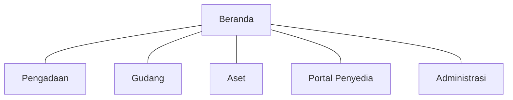

# Arsitektur informasi dan inventaris halaman — PRANATA UNY

Status: P7 candidate — VERIFYING (AUTH-012), belum disetujui | Updated: 2026-10-30 (Asia/Jakarta) | Custodian: Planning Agent | Phase: P7

Dokumen ini memiliki **ruang kerja, struktur navigasi, inventaris halaman (PG), pemetaan halaman ke kontrak rute P3 (RT), dashboard per peran, pencarian global dan konvensi URL**. Isi rute dan jalur kembali tetap dimiliki [ROUTE_CONTRACTS](../03-workflows/ROUTE_CONTRACTS.md); halaman di bawah adalah perwujudan P7 atas kontrak tersebut. Visibilitas menu mengikuti izin server ([ACCESS_CONTROL](../05-security/ACCESS_CONTROL.md)).

## 1. Ruang kerja dan navigasi utama

| Ruang kerja | Menu sidebar (urutan) |
|---|---|
| Beranda | Beranda · Inbox · Permintaan Barang Saya · Notifikasi |
| Pengadaan | Dasbor · Usulan Kebutuhan · Referensi RUP · Paket · Jadwal Kegiatan · Kontrak · Serah Terima & Klasifikasi · SPJ & Pembayaran · Penyedia & DPT · Laporan |
| Gudang | Dasbor · Permintaan · Serah Terima · Pengembalian · Stok & Kartu Stok · Barang Masuk · Stock Opname · Transfer · Katalog Barang · Laporan |
| Aset | Dasbor · Register Aset · Penerimaan Aset · Mutasi · Inventarisasi · Perubahan Aset · Penghapusan · Penyusutan · KDP · Rekonsiliasi · Intake Data · Laporan |
| Portal Penyedia | Beranda · Profil Perusahaan · Dokumen & DPT · Partisipasi |
| Administrasi | Dasbor Sistem · Pengguna · Akses & Persetujuan · Penugasan · Organisasi · Data Referensi · Kebijakan · Template Dokumen · Penomoran · Gudang · Audit |

Header global: pencarian (palette), inbox dengan hitungan, pemilih bahasa (ID/EN), menu akun. Pemilih gudang muncul di ruang kerja Gudang bila pengguna berhak atas lebih dari satu gudang; pilihan diingat per pengguna. Konteks ruang kerja dan gudang tampil jelas di header agar pengguna tidak salah konteks.

## 2. Konvensi URL dan nama rute

Path berbahasa Inggris dan stabil (penamaan teknis), label tampilan selalu terlokalisasi. Contoh: `/procurement/packages/{package}` (`procurement.packages.show`), `/warehouse/requests/{request}` (`inventory.requests.show`), `/assets/{asset}` (`assets.show`). Segmen ID memakai `public_id`. Filter/sort/cursor berada di query string sehingga tombol kembali memulihkan daftar.

## 3. Inventaris halaman

Kolom "Kembali" adalah tujuan back kontekstual default; kontrak lengkap di RT terkait.

### 3.1 Bersama

| PG | Halaman | Path | RT | Aksi utama | Kembali |
|---|---|---|---|---|---|
| PG-001 | Masuk | `/login` | RT-001 | Masuk | — |
| PG-002 | Aktivasi akun / ganti password wajib | `/activate`, `/password/change` | RT-001 | Simpan password | Masuk |
| PG-003 | Beranda (dasbor per peran) | `/home` | RT-002 | Tindakan dari kartu Next-Action | — |
| PG-004 | Inbox pekerjaan | `/inbox` | RT-002 | Buka pekerjaan | Beranda |
| PG-005 | Permintaan barang saya | `/my/requests` | RT-033 | Buat permintaan | Beranda |
| PG-006 | Notifikasi | `/notifications` | RT-002 | Tandai dibaca | Asal |
| PG-007 | Akun & keamanan | `/account` | RT-001 | Simpan | Asal |
| PG-008 | Hasil pencarian | `/search` | RT-029 | Buka hasil | Asal pencarian |
| PG-009 | Status operasi | `/operations/{operation}` | RT-027/028 | Unduh hasil / ulangi | Asal |
| PG-010 | Dokumen (penampil/riwayat versi) | `/documents/{document}` | RT-028 | Unduh / unggah tanda tangan | Objek induk |
| PG-011 | Riwayat objek | panel/halaman `…/history` | RT-030 | — | Objek induk |
| PG-012 | Bukti objek | panel `…/evidence` | RT-031 | Unggah bukti | Objek induk |
| PG-013 | Halaman galat 403/404/419/429/500/503 | — | Semua | Kembali/coba lagi | Asal sah |

### 3.2 Pengadaan

| PG | Halaman | Path | RT/WF | Aksi utama | Kembali |
|---|---|---|---|---|---|
| PG-101 | Dasbor Pengadaan | `/procurement` | RT-002 | Buka antrean | — |
| PG-102 | Usulan kebutuhan (daftar/detail/form) | `/procurement/needs` | RT-003 / WF-003 | Ajukan usulan | Daftar usulan |
| PG-103 | Referensi RUP | `/procurement/rup` | RT-004 / WF-004 | Catat referensi | Daftar/paket asal |
| PG-104 | Daftar paket | `/procurement/packages` | RT-005 | Buat paket | — |
| PG-105 | Detail paket (tab: Ringkasan, Item, HPS, Metode, Pemilihan, Hasil, Kontrak, Dokumen, Riwayat) | `/procurement/packages/{p}` | RT-005 / WF-005 | Tindakan berikut sesuai state | Daftar paket (filter terjaga) |
| PG-106 | Buat/ubah paket (bertahap) | `/procurement/packages/create`, `…/{p}/edit` | RT-005 | Simpan draf / ajukan | Detail/daftar |
| PG-107 | Penyusun HPS | `/procurement/packages/{p}/hps` | RT-005 | Simpan/ajukan/tetapkan | Detail paket tab HPS |
| PG-108 | Penetapan metode | `/procurement/packages/{p}/method` | RT-035 / WF-032 | Minta saran / tetapkan | Detail paket tab Metode |
| PG-109 | Jadwal kegiatan (kalender + daftar) | `/procurement/activities` | RT-006 / WF-006 | Jadwalkan / catat hasil | Paket atau kalender asal |
| PG-110 | Partisipasi & kiriman paket | `/procurement/packages/{p}/participants` | RT-008 / WF-008 | Undang / catat kiriman | Detail paket |
| PG-111 | Evaluasi, klarifikasi, negosiasi | `/procurement/packages/{p}/assessment` | RT-009 / WF-009 | Catat hasil | Detail paket |
| PG-112 | Hasil/penetapan pemenang | `/procurement/packages/{p}/result` | RT-010 / WF-010 | Usulkan/tetapkan | Detail paket |
| PG-113 | SPPBJ | `/procurement/packages/{p}/sppbj` | RT-011 / WF-011 | Siapkan/periksa/terbitkan | Detail paket |
| PG-114 | Kontrak (daftar/detail) | `/procurement/contracts`, `/{c}` | RT-012 / WF-012 | Siapkan/catat tanda tangan | Daftar/paket asal |
| PG-115 | Adendum | `/procurement/contracts/{c}/amendments` | RT-036 / WF-033 | Usulkan/putuskan | Detail kontrak |
| PG-116 | Pelaksanaan/progres | `/procurement/contracts/{c}/progress` | RT-013 / WF-013 | Catat progres | Detail kontrak |
| PG-117 | Pemeriksaan & BAST | `/procurement/contracts/{c}/handovers` | RT-014 / WF-014 | Catat pemeriksaan/BAST | Detail kontrak |
| PG-118 | SPJ & pembayaran | `/procurement/contracts/{c}/accountability` | RT-015 / WF-015 | Lengkapi/catat | Detail kontrak |
| PG-119 | Klasifikasi & handoff hilir | `/procurement/handoffs` | RT-016 / WF-016 | Klasifikasikan / buat draf | BAST asal |
| PG-120 | Penyedia & DPT (internal) | `/procurement/vendors` | RT-007 / WF-007 | Verifikasi dokumen / putuskan DPT | Daftar penyedia |
| PG-121 | Laporan pengadaan | `/procurement/reports` | RT-027 / WF-027 | Minta laporan | Dasbor |

### 3.3 Gudang

| PG | Halaman | Path | RT/WF | Aksi utama | Kembali |
|---|---|---|---|---|---|
| PG-201 | Dasbor gudang | `/warehouse` | RT-002 | Buka antrean | — |
| PG-202 | Permintaan (daftar, antrean keputusan, detail, form) | `/warehouse/requests` | RT-033 / WF-030 | Ajukan / putuskan | Daftar/antrean asal |
| PG-203 | Serah terima | `/warehouse/requests/{r}/handover` | RT-033 / WF-030 | Catat serah terima | Detail permintaan |
| PG-204 | Konfirmasi penerima | `/warehouse/handovers/{h}/confirm` | RT-033 / IX-022 | Konfirmasi / laporkan selisih | Permintaan saya |
| PG-205 | Pengembalian | `/warehouse/returns` | RT-034 / WF-031 | Ajukan / terima / catat pemeriksaan | Daftar/serah terima asal |
| PG-206 | Stok & kartu stok | `/warehouse/stock`, `/warehouse/items/{i}/ledger` | RT-023 / WF-023 | Lihat ledger | Daftar stok |
| PG-207 | Barang masuk | `/warehouse/receipts` | RT-023 / WF-023 | Catat penerimaan | Daftar |
| PG-208 | Stock opname | `/warehouse/counts` | RT-023 / WF-023 | Catat hitung / usulkan penyesuaian | Daftar |
| PG-209 | Transfer antar gudang | `/warehouse/transfers` | RT-023 / WF-023 | Kirim / terima | Daftar |
| PG-210 | Katalog barang | `/warehouse/items` | RT-023 / RT-032 | Tambah/ubah barang | Daftar |
| PG-211 | Laporan gudang | `/warehouse/reports` | RT-027 | Minta laporan | Dasbor |

### 3.4 Aset

| PG | Halaman | Path | RT/WF | Aksi utama | Kembali |
|---|---|---|---|---|---|
| PG-301 | Dasbor aset | `/assets/dashboard` | RT-002 | Buka antrean | — |
| PG-302 | Register aset (1 juta baris, server-driven) | `/assets` | RT-017 | Cari/filter/ekspor | — |
| PG-303 | Detail aset (tab: Ringkasan, Riwayat, Penempatan, Kondisi & Pemeliharaan, Nilai & Penyusutan, Dokumen) | `/assets/{a}` | RT-017/030/031 | Tindakan sesuai state | Register (filter terjaga) |
| PG-304 | Penerimaan aset (draf dari handoff/manual) | `/assets/registrations` | RT-017 / WF-017 | Lengkapi/terima | Asal handoff/daftar |
| PG-305 | Mutasi | `/assets/mutations` | RT-018 / WF-018 | Usulkan/putuskan | Aset/daftar |
| PG-306 | Inventarisasi | `/assets/verifications` | RT-019 / WF-019 | Catat temuan | Daftar |
| PG-307 | Perubahan aset (koreksi/pengembangan/reklasifikasi) | `/assets/changes` | RT-020 / WF-020 | Usulkan/putuskan | Aset |
| PG-308 | Penghapusan | `/assets/disposals` | RT-021 / WF-021 | Usulkan/catat keputusan | Daftar |
| PG-309 | Penyusutan | `/assets/depreciation` | RT-022 / WF-022 | Jalankan/lihat run | Dasbor |
| PG-310 | KDP | `/assets/kdp` | RT-024 / WF-024 | Catat biaya/penyelesaian | Daftar |
| PG-311 | Rekonsiliasi | `/reconciliation` | RT-025 / WF-025 | Buka kasus/selisih | Daftar |
| PG-312 | Intake data historis | `/intake` | RT-026 / WF-026 | Unggah/validasi/putuskan | Daftar batch |
| PG-313 | Laporan aset | `/assets/reports` | RT-027 / WF-027 | Minta laporan | Dasbor |

### 3.5 Portal Penyedia

| PG | Halaman | Path | RT/WF | Aksi utama | Kembali |
|---|---|---|---|---|---|
| PG-401 | Beranda penyedia | `/vendor` | RT-002 | Lihat kewajiban | — |
| PG-402 | Profil perusahaan & PIC | `/vendor/profile` | RT-007 / WF-007 | Perbarui data | Beranda |
| PG-403 | Dokumen & status DPT | `/vendor/documents` | RT-007 / WF-007 | Unggah dokumen | Beranda |
| PG-404 | Partisipasi (daftar/detail) | `/vendor/participations` | RT-008 / WF-008 | Lihat undangan/status | Daftar |
| PG-405 | Kirim/revisi (hanya bila kebijakan kanal mengizinkan) | `/vendor/participations/{x}/submissions` | RT-008 | Kirim | Detail partisipasi |

### 3.6 Administrasi

| PG | Halaman | Path | RT | Aksi utama | Kembali |
|---|---|---|---|---|---|
| PG-501 | Dasbor sistem | `/admin` | RT-002 | Tinjau peringatan | — |
| PG-502 | Pengguna | `/admin/users` | RT-001 | Buat/nonaktifkan/reset dibantu | Daftar |
| PG-503 | Akses & persetujuan grant | `/admin/access` | RT-002 | Beri/setujui/cabut | Daftar |
| PG-504 | Penugasan proses | `/admin/assignments` | RT-002 | Lihat/akhiri | Daftar |
| PG-505 | Organisasi (unit, jabatan, penunjukan) | `/admin/organization` | RT-032 / WF-029 | Ajukan perubahan | Daftar |
| PG-506 | Data referensi | `/admin/reference` | RT-032 / WF-029 | Ajukan perubahan | Daftar |
| PG-507 | Kebijakan | `/admin/policies` | RT-032 / WF-029 | Susun/ajukan/aktifkan | Paket kebijakan |
| PG-508 | Template dokumen | `/admin/templates` | RT-032/028 | Unggah/aktifkan versi | Daftar |
| PG-509 | Penomoran | `/admin/numbering` | RT-032 | Lihat skema/nomor | Daftar |
| PG-510 | Gudang (master) | `/admin/warehouses` | RT-032 / WF-029 F7 | Ajukan perubahan | Daftar |
| PG-511 | Audit | `/admin/audit` | RT-030 | Cari/baca teraudit (IX-024) | Daftar |

## 4. Dasbor per peran

| Peran (profil/penugasan) | Kartu utama |
|---|---|
| Operator usulan unit | Usulan saya per status, perlu perbaikan, permintaan barang saya, paket terkait usulan |
| Staf pengadaan pusat | Antrean usulan masuk, paket per tahap/metode, tenggat yang tervalidasi, dokumen yang perlu dibuat, kelengkapan dokumen penyedia, SPJ belum lengkap |
| Pejabat dengan penugasan (PPK, Pokja, Pejabat Pengadaan, penetap metode) | Kartu sorot navy "Perlu keputusan Anda" + daftar pekerjaan menurut penugasan |
| Petugas/Admin gudang | Permintaan menunggu serah terima, permintaan menunggu keputusan (bila berhak), konfirmasi tertunda, stok di bawah minimum, opname aktif |
| Operator/Staf aset | Draf penerimaan aset, mutasi menunggu, inventarisasi berjalan, selisih rekonsiliasi, status run penyusutan |
| Pimpinan | Ringkasan per unit: paket berjalan, nilai kontrak, aset per kondisi, stok kritis — tanpa aksi keputusan kecuali penugasan |
| Penyedia | Undangan aktif, dokumen kedaluwarsa/perlu diperbarui, status DPT, partisipasi dan hasil yang diumumkan |
| Super Admin | Kesehatan sistem, antrean/job gagal, grant menunggu persetujuan, kebijakan DRAFT vs ACTIVE, peristiwa keamanan |

Semua angka dasbor dihitung server dalam cakupan pengguna; kartu kosong menjelaskan alasannya (tidak ada data vs belum berhak vs kebijakan belum aktif).

## 5. Pencarian global

Palette (`Ctrl/⌘ K`) dan halaman `/search` mencari paket, kontrak, penyedia, aset (nomor/nama/serial), barang, permintaan dan dokumen bernomor dalam cakupan pengguna, dikelompokkan per modul, maks. 10 hasil per modul, minimal 3 karakter. Hasil membuka RT pemilik; Escape mengembalikan fokus ke asal.

## 6. Pemetaan ke kontrak P3

Setiap RT-001–RT-036 memiliki minimal satu halaman di atas; RT-029–RT-031 diwujudkan sebagai halaman dan panel kontekstual. Setiap IX yang applicable diwujudkan sebagai pola interaksi pada [INTERACTION_PATTERNS](INTERACTION_PATTERNS.md). Uji integritas rute (P8) memastikan setiap item menu, tombol dan tautan mengarah ke rute yang ada, berotorisasi dan memiliki jalur kembali.
