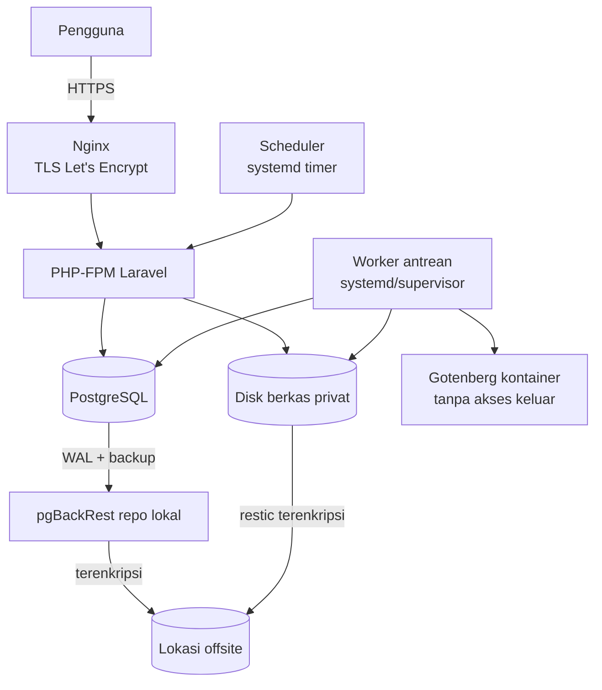

# Infrastruktur, observabilitas, cadangan dan pemulihan — PRANATA UNY

Status: P9 — APPROVED (APPR-006); baseline beku FRZ-001 | Updated: 2026-11-01 (Asia/Jakarta) | Custodian: Planning Agent | Phase: P9

Dokumen ini memiliki **lingkungan, topologi, kontainer pengembangan yang terisolasi, CI, staging/produksi, batas sumber daya, rahasia, logging/pemantauan, cadangan/pemulihan, keamanan server, inventaris biaya dan respons insiden**. Prosedur langkah demi langkah ada di [OPERATIONS_RUNBOOK](OPERATIONS_RUNBOOK.md). Pilihan yang memerlukan keputusan Owner ditandai **[KEPUTUSAN OWNER]**. Tidak ada infrastruktur yang dibuat oleh dokumen ini.

## 1. Lingkungan

| Lingkungan | Tujuan | Data | Siapa mengakses |
|---|---|---|---|
| Lokal (PC Windows Owner) | Penyuntingan, Git, pengaman eksekutor dan alat ringan saja; tanpa Docker, basis data atau layanan PRANATA (OD-37) | Sintetis; masukan privat paritas hanya di `.pranata/private/` | Eksekutor (Claude Code) dan Owner |
| CI (GitHub Actions, runner GitHub-hosted) | Lingkungan utama uji berat per PR: PHP, PostgreSQL dan Gotenberg sebagai service container, build, E2E | Sintetis, dibuat per job | GitHub |
| Staging | Integrasi, E2E penuh, uji performa, UAT | Sintetis atau teranonimkan yang disetujui | Tim UAT, operator |
| Produksi | Operasi resmi | Riil | Pengguna; operator produksi yang ditunjuk Owner **[KEPUTUSAN OWNER]** |

Agen eksekusi tidak memiliki kredensial staging/produksi; deploy dilakukan oleh operator atau workflow yang memerlukan persetujuan Owner. Repositori bersifat **publik**: tidak ada rahasia, konfigurasi produksi, data riil atau artefak sensitif di repositori, issue, PR atau log CI.

## 2. Pengembangan lokal terisolasi

Mesin Owner juga menjalankan MULTIPLECORP, BantuKasir dan ELLIGBLE. PRANATA wajib terisolasi penuh:

| Aspek | Aturan (OD-37) |
|---|---|
| Docker | Tidak ada Docker atau Docker Compose untuk PRANATA di PC Owner, termasuk perintah baca-saja; Docker, WSL dan proyek lain tidak di-restart, dihentikan, dikonfigurasi ulang atau diganggu |
| Alat lokal | Penyunting, Git, GitHub CLI, Node/npm, PowerShell, Claude Code dan pengaman eksekutor; alat ringan lain hanya dalam lingkup proyek ([TOOLCHAIN](../00-governance/TOOLCHAIN.md#docker-free-development-topology-pcr-002-od-37)) |
| Perubahan sistem | Tanpa instalasi atau perubahan global PHP, Composer, PostgreSQL, variabel lingkungan, PATH atau layanan sistem kecuali dengan otorisasi Owner terpisah |
| Uji berat | Runner GitHub-hosted: PHP, `composer install`, PostgreSQL dan Gotenberg sebagai service container, Pest, build, E2E ([QUALITY_GATES §4](../08-testing/QUALITY_GATES.md#4-pipeline-ci-github-actions)) |
| Runner | Hanya runner GitHub-hosted; runner GitHub Actions self-hosted di PC Owner dilarang. Runner headless Claude Code lokal (`scripts/executor/runner.ps1`) bukan runner Actions |
| Basis data | Tidak ada basis data PRANATA lokal; `pranata_test*`, `pranata_e2e_*` dan `pranata_perf` hanya pada service container CI yang dibuang setelah job (atau di staging bila diputuskan) |
| Data | Hanya data sintetis di GitHub; data institusi, berkas privat dan kredensial tidak diunggah |
| Biaya | Repositori publik: runner standar GitHub-hosted tanpa biaya menit; tanpa layanan berbayar |

Pengukuran sumber daya lokal (bind mount, batas kontainer) tidak berlaku lagi (C-14 SUPERSEDED). Durasi job GitHub-hosted diukur pada TASK-003 dan TASK-005.

## 3. CI

GitHub Actions dengan runner GitHub (repositori publik — tanpa biaya menit). Desain workflow di [QUALITY_GATES](../08-testing/QUALITY_GATES.md). Rahasia CI hanya untuk uji. Cabang terlindungi: `main` (integrasi Task berbasis trunk) dengan status check wajib `ci-gate` dan larangan force push/penghapusan; aturan PR wajib hanya pada opsi merge B (D-08, [QUALITY_GATES §4](../08-testing/QUALITY_GATES.md#4-pipeline-ci-github-actions)); tag rilis `v*` dilindungi dan produksi hanya dari tag ([RELEASE_PLAN §4](../10-release/RELEASE_PLAN.md#4-versi-dan-cabang)). Ruleset diterapkan Owner setelah `ci-gate` terbukti (TASK-005); eksekutor tidak mengubah ruleset. Sebelum TASK-005, workflow bootstrap sementara memberi bukti untuk TASK-002–TASK-004 ([QUALITY_GATES §4.1](../08-testing/QUALITY_GATES.md#41-workflow-bootstrap-sementara)). Tidak ada runner self-hosted (OD-37).

## 4. Topologi staging dan produksi

| Keputusan | Usulan | Status |
|---|---|---|
| Penyedia server | VPS yang dibiayai klien atau server UNY | **[KEPUTUSAN OWNER]** |
| Spesifikasi produksi | 4 vCPU / 8 GB RAM / SSD 160 GB (16 GB RAM bila ClamAV) | Usulan, divalidasi uji beban staging |
| Staging | Server terpisah yang lebih kecil (2 vCPU / 4 GB) atau VM terpisah | **[KEPUTUSAN OWNER]** — D-19; tidak di PC Owner (OD-37); lokasi dikonfirmasi Owner sebelum TASK-040 |
| Domain | Subdomain UNY atau domain klien; TLS otomatis | **[KEPUTUSAN OWNER]** |
| Cara deploy | Skrip deploy idempoten (git pull tag → composer/npm build → migrate dengan peran pemilik → optimize → restart worker) dijalankan operator atau workflow GitHub manual dengan persetujuan lingkungan | Usulan |
| Kontainer di produksi | Gotenberg (dan ClamAV bila diaktifkan) sebagai kontainer; aplikasi native atau kontainer — dipilih saat TASK infrastruktur | Usulan |

## 5. Konfigurasi dan rahasia

`.env` produksi berada hanya di server (pemilik user layanan, izin 0600), tidak di repositori. Nilai wajib: `APP_KEY`, kredensial DB per peran (`DB_USERNAME` aplikasi, `DB_MIGRATOR_*`), `PRANATA_ALLOW_DRAFT_POLICIES=false`, konfigurasi mail (opsional), path penyimpanan, URL Gotenberg internal. `APP_KEY` dicadangkan terpisah secara terenkripsi. Rotasi rahasia mengikuti runbook.

## 6. Logging dan pemantauan

| Kebutuhan | Solusi (gratis/self-hosted) |
|---|---|
| Log aplikasi | Laravel log harian format JSON, logrotate, retensi 30 hari (aplikasi) / 90 hari (keamanan) — sampai kebijakan retensi GAP-023 |
| Metrik aplikasi | Laravel Pulse (first-party) di Administrasi, hanya Super Admin |
| Kesehatan | `/up` + `/health/ready` (DB, antrean, disk, Gotenberg) untuk pemantau |
| Uptime eksternal | Pemeriksa uptime gratis (mis. Uptime Kuma pada host terpisah milik klien, atau layanan free tier dengan risiko tercatat) **[KEPUTUSAN OWNER]** |
| Galat | Kartu exception Pulse + log; pelacak galat self-hosted (GlitchTip) hanya bila diputuskan kelak |
| Peringatan | Email (bila SMTP) atau kanal yang dipilih Owner untuk: situs mati, disk > 80%, antrean tertahan > 15 menit, job gagal, cadangan gagal, peristiwa keamanan (SECURITY_MODEL §9) **[KEPUTUSAN OWNER: penerima]** |

## 7. Cadangan dan pemulihan

| Objek | Metode | Frekuensi | Retensi usulan |
|---|---|---|---|
| PostgreSQL | pgBackRest: full mingguan, differential harian, arsip WAL kontinu (`archive_timeout` 300 detik) | Kontinu | 4 minggu full + WAL; 12 snapshot bulanan |
| Berkas privat | restic snapshot | Per jam (inkremental) + harian | 30 harian, 12 bulanan |
| Konfigurasi server dan `APP_KEY` | Salinan terenkripsi terpisah | Saat berubah | Semua versi |
| Lokasi offsite | Server UNY kedua, penyimpanan objek, atau lokasi lain yang dibiayai klien; terenkripsi di sisi klien | — | **[KEPUTUSAN OWNER]** |

Target desain **RTO ≤ 4 jam, RPO ≤ 1 jam** (OD-32, NFR-O01/O02). Dengan WAL setiap ≤ 5 menit ke repositori lokal dan sinkronisasi offsite ≤ 15 menit, RPO teoretis jauh di bawah 1 jam; klaim hanya sah setelah uji restore nyata:

- **Latihan restore bulanan** ke staging (basis data PITR ke waktu tertentu + berkas), mengukur durasi dan memverifikasi integritas (jumlah baris kunci, verifikasi saldo ledger, checksum berkas sampel, serta job verifikasi integritas untuk sidik jari tangkapan dan seluruh berkas bersegel sesuai RB-07).
- **Latihan pemulihan bencana triwulanan** dari offsite ke server bersih mengikuti runbook, mencatat waktu aktual terhadap RTO.
- Hasil dicatat sebagai bukti operasi; kegagalan memicu tindakan korektif sebelum rilis berikutnya.

## 8. Keamanan server

SSH dengan kunci saja, tanpa login root, port SSH dibatasi; firewall hanya 80/443 publik; fail2ban; pembaruan keamanan otomatis untuk OS; jendela pemeliharaan bulanan untuk PHP/Nginx/PostgreSQL minor; PostgreSQL hanya mendengar localhost/jaringan privat; Gotenberg tanpa akses jaringan keluar; peran DB terpisah (DATA_MODEL §2); `statement_timeout` per peran; audit akses server oleh operator.

## 9. Inventaris biaya berulang

| Item | Biaya tambahan | Catatan |
|---|---|---|
| Server produksi + staging | Dibiayai klien | **[KEPUTUSAN OWNER]** |
| Domain/TLS | Domain dibiayai klien atau subdomain UNY; TLS gratis | |
| Penyimpanan offsite | 0 bila server UNY kedua; berbayar bila penyimpanan objek (pengecualian berbayar perlu persetujuan) | **[KEPUTUSAN OWNER]** |
| SMTP | 0 bila tidak dipakai; berbayar bila layanan pihak ketiga | Opsional |
| Semua perangkat lunak | 0 (open-source/first-party) | Laravel, PostgreSQL, Nginx, Gotenberg, pgBackRest, restic, Pulse, Playwright, k6 |
| CI | 0 (repositori publik) | Bila repositori menjadi privat, kuota menit perlu ditinjau |

Tidak ada pengecualian berbayar yang disetujui saat ini.

## 10. Respons insiden

| Tingkat | Contoh | Respons |
|---|---|---|
| S1 | Layanan mati, kebocoran data, data rusak | Segera; operator + Owner; pertimbangkan mode pemeliharaan; pemulihan dari cadangan bila perlu |
| S2 | Fitur inti tidak dapat dipakai (dokumen, serah terima) | Hari kerja yang sama |
| S3 | Fitur sekunder terganggu | Rilis perbaikan terjadwal |
| S4 | Kosmetik | Backlog |

Setiap S1/S2 menghasilkan catatan insiden (kronologi, dampak, akar masalah, tindakan) tanpa data pribadi. Agen eksekusi tidak bertindak pada produksi; perbaikan melalui Task dan rilis.
