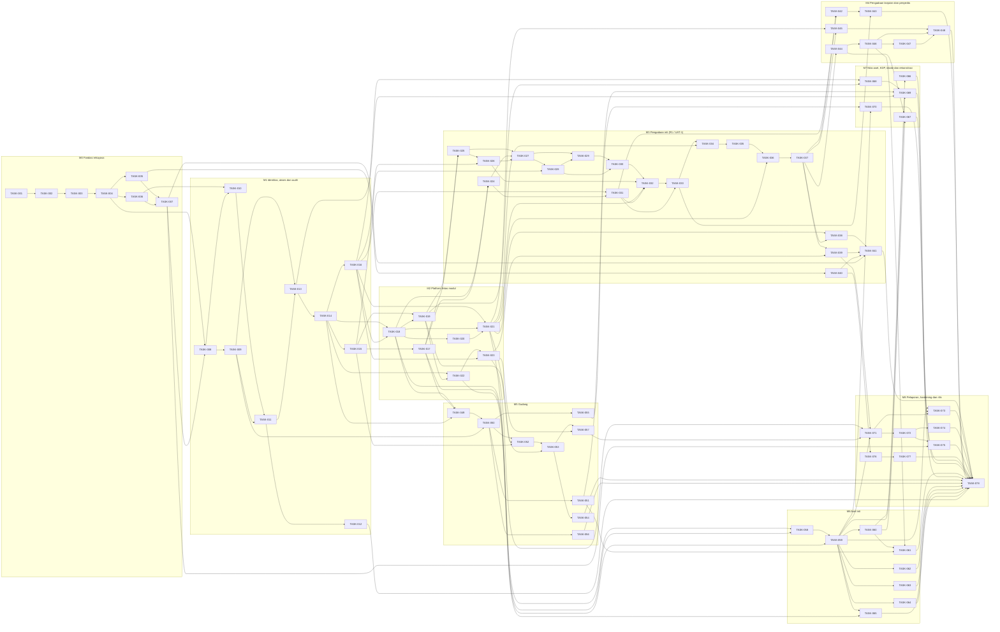

# Rencana Task — PRANATA UNY

Status: P11 candidate — VERIFYING (AUTH-012), belum disetujui | Updated: 2026-10-30 (Asia/Jakarta) | Custodian: Planning Agent | Phase: P11

Dokumen ini adalah **dasbor kemajuan Owner** dan baseline Task (AICWDF §22, §35). Task dirancang sendiri oleh Claude Planning dari P1–P10; tidak menyalin daftar MULTIPLECORP atau draf ChatGPT. Baseline baru berlaku setelah Owner menyetujui kandidat P11 dan Planning Freeze tercatat; sebelum itu tidak ada Task READY dan tidak ada eksekusi.

## Status proyek

```text
PROJECT TASK STATUS

Baseline Total Tasks: 78 (diusulkan; final saat persetujuan P11)
Current Total Tasks: 78

DONE: 0
READY: 0
IN_PROGRESS: 0
BLOCKED: 0
VERIFYING: 0
TODO: 78
SUPERSEDED: 0

Progress: 0 / 78
Percentage: 0%
```

```text
CURRENT TASK: —
NEXT READY TASK: TASK-001 setelah persetujuan P4–P11, Planning Freeze dan otorisasi eksekusi
LAST TASK PLAN CHANGE: — (baseline kandidat)
ADDITIONAL RECURRING PRODUCTION COST: 0 di luar infrastruktur yang dibiayai klien
PAID SERVICE EXCEPTIONS: NONE
```

## Milestone

| Milestone | Isi | Task | Increment rilis | Gerbang |
|---|---|---|---|---|
| M0 | Fondasi rekayasa | TASK-001–TASK-007 (7) | R0 | Mode otonom hanya setelah TASK-001 terverifikasi + otorisasi Owner |
| M1 | Identitas, akses dan audit | TASK-008–TASK-016 (9) | R0 | — |
| M2 | Platform lintas modul | TASK-017–TASK-023 (7) | R0 | — |
| M3 | Pengadaan inti (R1 / UAT-1) | TASK-024–TASK-041 (18) | R1 | UAT-1 Pengadaan (OD-32) |
| M4 | Pengadaan lanjutan dan penyedia | TASK-042–TASK-048 (7) | R3 (TASK-044, TASK-046) / R4 (sisanya) | — |
| M5 | Gudang | TASK-049–TASK-057 (9) | R2 | UAT-2 Gudang |
| M6 | Aset inti | TASK-058–TASK-065 (8) | R3 | — |
| M7 | Nilai aset, KDP, intake dan rekonsiliasi | TASK-066–TASK-070 (5) | R3 (TASK-070 diuji pada R4) | UAT-3 Aset |
| M8 | Pelaporan, hardening dan rilis | TASK-071–TASK-078 (8) | R4 | UAT-4 + kesiapan rilis + keputusan go-live Owner |

Increment dan UAT didefinisikan di [RELEASE_PLAN](../10-release/RELEASE_PLAN.md#1-increment) dan [UAT_PLAN](../10-release/UAT_PLAN.md). Urutan eksekusi default: Task TODO bernomor terkecil yang seluruh dependensi dan prasyaratnya terpenuhi ([EXECUTOR_OPERATING_MODEL](EXECUTOR_OPERATING_MODEL.md)); Owner dapat menetapkan prioritas lain melalui TASK PLAN CHANGE.

## Master Task Checklist

- [ ] [TASK-001](TASK-001.md) — Pagar pengaman eksekutor, runner dan verifikasi kemampuan (mode terawasi)
- [ ] [TASK-002](TASK-002.md) — Bootstrap aplikasi Laravel React dan struktur modul
- [ ] [TASK-003](TASK-003.md) — Lingkungan pengembangan terisolasi `pranata` dan pengaman basis data uji
- [ ] [TASK-004](TASK-004.md) — Perkakas kualitas dan uji arsitektur
- [ ] [TASK-005](TASK-005.md) — Pipeline CI dan pemeriksa dokumentasi
- [ ] [TASK-006](TASK-006.md) — Token desain, AppShell dan lokalisasi id/en
- [ ] [TASK-007](TASK-007.md) — Harness E2E Playwright, axe dan seeder skenario
- [ ] [TASK-008](TASK-008.md) — Peran basis data, tabel append-only dan jejak audit
- [ ] [TASK-009](TASK-009.md) — Kontrak perintah: idempotensi, versi optimistis, model galat dan request id
- [ ] [TASK-010](TASK-010.md) — Autentikasi lokal dan sesi
- [ ] [TASK-011](TASK-011.md) — Administrasi pengguna, aktivasi dan pemulihan dibantu admin
- [ ] [TASK-012](TASK-012.md) — TOTP 2FA untuk akun istimewa
- [ ] [TASK-013](TASK-013.md) — Organisasi berversi, jabatan dan penunjukan
- [ ] [TASK-014](TASK-014.md) — Model akses: kapabilitas, profil, grant bercakupan dan scope kueri
- [ ] [TASK-015](TASK-015.md) — Penugasan proses dan mesin pemisahan tugas
- [ ] [TASK-016](TASK-016.md) — Berkas privat: unggah, unduh terotorisasi dan audit
- [ ] [TASK-017](TASK-017.md) — Data referensi
- [ ] [TASK-018](TASK-018.md) — Policy Registry
- [ ] [TASK-019](TASK-019.md) — Mesin transisi workflow, item pekerjaan, inbox dan notifikasi
- [ ] [TASK-020](TASK-020.md) — Layanan penomoran
- [ ] [TASK-021](TASK-021.md) — Mesin dokumen: template, generasi, PDF, revisi, tanda tangan dan paket
- [ ] [TASK-022](TASK-022.md) — DataTable server-driven, pagination keyset dan pencarian global dasar
- [ ] [TASK-023](TASK-023.md) — Infrastruktur laporan dan ekspor asinkron
- [ ] [TASK-024](TASK-024.md) — Paket kebijakan pengadaan DRAFT dan kasus uji regulasi
- [ ] [TASK-025](TASK-025.md) — Usulan kebutuhan unit (WF-003)
- [ ] [TASK-026](TASK-026.md) — Referensi RUP dan referensi kanal eksternal (WF-004)
- [ ] [TASK-027](TASK-027.md) — Paket, item, referensi anggaran dan komitmen (WF-005 inti)
- [ ] [TASK-028](TASK-028.md) — Penugasan pejabat paket dan rencana langkah per metode
- [ ] [TASK-029](TASK-029.md) — HPS
- [ ] [TASK-030](TASK-030.md) — Penetapan metode (WF-032)
- [ ] [TASK-031](TASK-031.md) — Data penyedia inti: perusahaan, PIC, dokumen dan catatan DPT
- [ ] [TASK-032](TASK-032.md) — Kegiatan paket, jadwal dan undangan (WF-006)
- [ ] [TASK-033](TASK-033.md) — Partisipasi, pencatatan kiriman dan pembacaan teraudit (WF-008, IX-024)
- [ ] [TASK-034](TASK-034.md) — Evaluasi, klarifikasi dan negosiasi (WF-009)
- [ ] [TASK-035](TASK-035.md) — Hasil dan penetapan pemenang (WF-010)
- [ ] [TASK-036](TASK-036.md) — SPPBJ dengan empat tanggung jawab (WF-011)
- [ ] [TASK-037](TASK-037.md) — Kontrak/SPK dan versi kontrak (WF-012)
- [ ] [TASK-038](TASK-038.md) — Template dan provider dokumen pengadaan set awal
- [ ] [TASK-039](TASK-039.md) — Dasbor, inbox dan laporan pengadaan
- [ ] [TASK-040](TASK-040.md) — Lingkungan staging dan skrip deploy
- [ ] [TASK-041](TASK-041.md) — Kesiapan UAT-1 Pengadaan
- [ ] [TASK-042](TASK-042.md) — Verifikasi dokumen penyedia dan keputusan DPT (WF-007)
- [ ] [TASK-043](TASK-043.md) — Portal Penyedia
- [ ] [TASK-044](TASK-044.md) — Pelaksanaan kontrak, jaminan dan denda (WF-013)
- [ ] [TASK-045](TASK-045.md) — Adendum kontrak (WF-033)
- [ ] [TASK-046](TASK-046.md) — Pemeriksaan, serah terima dan BAST (WF-014)
- [ ] [TASK-047](TASK-047.md) — SPJ, paket dokumen dan pelacakan pembayaran (WF-015)
- [ ] [TASK-048](TASK-048.md) — Dokumen pengadaan set lanjutan
- [ ] [TASK-049](TASK-049.md) — Gudang, katalog barang dan paket kebijakan gudang DRAFT
- [ ] [TASK-050](TASK-050.md) — Ledger stok, saldo dan kartu stok
- [ ] [TASK-051](TASK-051.md) — Barang masuk dan saldo awal
- [ ] [TASK-052](TASK-052.md) — Permintaan barang dan keputusan (WF-030 bagian 1)
- [ ] [TASK-053](TASK-053.md) — Serah terima dan konfirmasi penerima (WF-030 bagian 2)
- [ ] [TASK-054](TASK-054.md) — Pengembalian barang (WF-031)
- [ ] [TASK-055](TASK-055.md) — Stock opname dan penyesuaian
- [ ] [TASK-056](TASK-056.md) — Transfer antar gudang
- [ ] [TASK-057](TASK-057.md) — Dasbor dan laporan gudang
- [ ] [TASK-058](TASK-058.md) — Klasifikasi aset berversi dan lokasi
- [ ] [TASK-059](TASK-059.md) — Register aset, transaksi aset dan daftar skala besar
- [ ] [TASK-060](TASK-060.md) — Penerimaan dan pengakuan aset (WF-017)
- [ ] [TASK-061](TASK-061.md) — Klasifikasi dan handoff hilir dari BAST (WF-016)
- [ ] [TASK-062](TASK-062.md) — Mutasi aset (WF-018)
- [ ] [TASK-063](TASK-063.md) — Inventarisasi dan pemeliharaan (WF-019)
- [ ] [TASK-064](TASK-064.md) — Perubahan aset: koreksi, pengembangan, reklasifikasi (WF-020)
- [ ] [TASK-065](TASK-065.md) — Penghapusan aset (WF-021)
- [ ] [TASK-066](TASK-066.md) — Penyusutan dan amortisasi (WF-022)
- [ ] [TASK-067](TASK-067.md) — KDP dan penyelesaian (WF-024)
- [ ] [TASK-068](TASK-068.md) — Kerangka intake historis (WF-026)
- [ ] [TASK-069](TASK-069.md) — Adapter intake: aset, barang, saldo awal persediaan dan organisasi
- [ ] [TASK-070](TASK-070.md) — Rekonsiliasi (WF-025)
- [ ] [TASK-071](TASK-071.md) — Katalog laporan menurut makna waktu (WF-027)
- [ ] [TASK-072](TASK-072.md) — Dasbor per peran dan pencarian global lengkap
- [ ] [TASK-073](TASK-073.md) — Data sintetis skala dan uji performa
- [ ] [TASK-074](TASK-074.md) — Regresi keamanan dan matriks otorisasi lengkap
- [ ] [TASK-075](TASK-075.md) — Audit aksesibilitas, konsistensi UI dan E2E lengkap
- [ ] [TASK-076](TASK-076.md) — Infrastruktur produksi dan pemantauan
- [ ] [TASK-077](TASK-077.md) — Cadangan, offsite dan latihan pemulihan
- [ ] [TASK-078](TASK-078.md) — Kesiapan rilis V1 dan go-live

## Tabel Task

| Task | Judul | Status | Risiko | Milestone | Depends On | Parallel Safe | DB Impact | UI Impact |
|---|---|---|---|---|---|---|---|---|
| [TASK-001](TASK-001.md) | Pagar pengaman eksekutor, runner dan verifikasi kemampuan (mode terawasi) | TODO | HIGH | M0 | — | NO | NONE | NO |
| [TASK-002](TASK-002.md) | Bootstrap aplikasi Laravel React dan struktur modul | TODO | HIGH | M0 | TASK-001 | NO | PROPOSED | YES |
| [TASK-003](TASK-003.md) | Lingkungan pengembangan terisolasi `pranata` dan pengaman basis data uji | TODO | STANDARD | M0 | TASK-002 | NO | NONE | NO |
| [TASK-004](TASK-004.md) | Perkakas kualitas dan uji arsitektur | TODO | STANDARD | M0 | TASK-003 | NO | NONE | NO |
| [TASK-005](TASK-005.md) | Pipeline CI dan pemeriksa dokumentasi | TODO | STANDARD | M0 | TASK-004 | YES | NONE | NO |
| [TASK-006](TASK-006.md) | Token desain, AppShell dan lokalisasi id/en | TODO | STANDARD | M0 | TASK-004 | YES | NONE | YES |
| [TASK-007](TASK-007.md) | Harness E2E Playwright, axe dan seeder skenario | TODO | STANDARD | M0 | TASK-005, TASK-006 | NO | NONE | YES |
| [TASK-008](TASK-008.md) | Peran basis data, tabel append-only dan jejak audit | TODO | HIGH | M1 | TASK-004, TASK-007 | NO | PROPOSED | NO |
| [TASK-009](TASK-009.md) | Kontrak perintah: idempotensi, versi optimistis, model galat dan request id | TODO | HIGH | M1 | TASK-008 | NO | PROPOSED | YES |
| [TASK-010](TASK-010.md) | Autentikasi lokal dan sesi | TODO | HIGH | M1 | TASK-006, TASK-008 | NO | PROPOSED | YES |
| [TASK-011](TASK-011.md) | Administrasi pengguna, aktivasi dan pemulihan dibantu admin | TODO | HIGH | M1 | TASK-010, TASK-009 | NO | PROPOSED | YES |
| [TASK-012](TASK-012.md) | TOTP 2FA untuk akun istimewa | TODO | HIGH | M1 | TASK-011 | YES | PROPOSED | YES |
| [TASK-013](TASK-013.md) | Organisasi berversi, jabatan dan penunjukan | TODO | HIGH | M1 | TASK-009, TASK-011 | NO | PROPOSED | YES |
| [TASK-014](TASK-014.md) | Model akses: kapabilitas, profil, grant bercakupan dan scope kueri | TODO | HIGH | M1 | TASK-013 | NO | PROPOSED | YES |
| [TASK-015](TASK-015.md) | Penugasan proses dan mesin pemisahan tugas | TODO | HIGH | M1 | TASK-014 | NO | PROPOSED | YES |
| [TASK-016](TASK-016.md) | Berkas privat: unggah, unduh terotorisasi dan audit | TODO | HIGH | M1 | TASK-014 | YES | PROPOSED | YES |
| [TASK-017](TASK-017.md) | Data referensi | TODO | STANDARD | M2 | TASK-015 | YES | PROPOSED | YES |
| [TASK-018](TASK-018.md) | Policy Registry | TODO | HIGH | M2 | TASK-014, TASK-016 | NO | PROPOSED | YES |
| [TASK-019](TASK-019.md) | Mesin transisi workflow, item pekerjaan, inbox dan notifikasi | TODO | STANDARD | M2 | TASK-015, TASK-018 | NO | PROPOSED | YES |
| [TASK-020](TASK-020.md) | Layanan penomoran | TODO | HIGH | M2 | TASK-018 | YES | PROPOSED | YES |
| [TASK-021](TASK-021.md) | Mesin dokumen: template, generasi, PDF, revisi, tanda tangan dan paket | TODO | HIGH | M2 | TASK-016, TASK-018, TASK-020 | NO | PROPOSED | YES |
| [TASK-022](TASK-022.md) | DataTable server-driven, pagination keyset dan pencarian global dasar | TODO | STANDARD | M2 | TASK-014, TASK-019 | YES | PROPOSED | YES |
| [TASK-023](TASK-023.md) | Infrastruktur laporan dan ekspor asinkron | TODO | STANDARD | M2 | TASK-022, TASK-016 | YES | PROPOSED | YES |
| [TASK-024](TASK-024.md) | Paket kebijakan pengadaan DRAFT dan kasus uji regulasi | TODO | HIGH | M3 | TASK-018, TASK-017 | NO | NONE | NO |
| [TASK-025](TASK-025.md) | Usulan kebutuhan unit (WF-003) | TODO | STANDARD | M3 | TASK-019, TASK-017 | NO | PROPOSED | YES |
| [TASK-026](TASK-026.md) | Referensi RUP dan referensi kanal eksternal (WF-004) | TODO | STANDARD | M3 | TASK-025, TASK-016 | YES | PROPOSED | YES |
| [TASK-027](TASK-027.md) | Paket, item, referensi anggaran dan komitmen (WF-005 inti) | TODO | HIGH | M3 | TASK-025, TASK-024, TASK-026 | NO | PROPOSED | YES |
| [TASK-028](TASK-028.md) | Penugasan pejabat paket dan rencana langkah per metode | TODO | HIGH | M3 | TASK-027, TASK-015 | NO | PROPOSED | YES |
| [TASK-029](TASK-029.md) | HPS | TODO | HIGH | M3 | TASK-027, TASK-028 | NO | PROPOSED | YES |
| [TASK-030](TASK-030.md) | Penetapan metode (WF-032) | TODO | HIGH | M3 | TASK-029, TASK-028 | NO | PROPOSED | YES |
| [TASK-031](TASK-031.md) | Data penyedia inti: perusahaan, PIC, dokumen dan catatan DPT | TODO | HIGH | M3 | TASK-016, TASK-024 | YES | PROPOSED | YES |
| [TASK-032](TASK-032.md) | Kegiatan paket, jadwal dan undangan (WF-006) | TODO | STANDARD | M3 | TASK-030, TASK-026, TASK-021, TASK-031 | YES | PROPOSED | YES |
| [TASK-033](TASK-033.md) | Partisipasi, pencatatan kiriman dan pembacaan teraudit (WF-008, IX-024) | TODO | HIGH | M3 | TASK-032, TASK-031 | NO | PROPOSED | YES |
| [TASK-034](TASK-034.md) | Evaluasi, klarifikasi dan negosiasi (WF-009) | TODO | HIGH | M3 | TASK-033, TASK-021 | NO | PROPOSED | YES |
| [TASK-035](TASK-035.md) | Hasil dan penetapan pemenang (WF-010) | TODO | HIGH | M3 | TASK-034 | NO | PROPOSED | YES |
| [TASK-036](TASK-036.md) | SPPBJ dengan empat tanggung jawab (WF-011) | TODO | HIGH | M3 | TASK-035, TASK-021 | NO | PROPOSED | YES |
| [TASK-037](TASK-037.md) | Kontrak/SPK dan versi kontrak (WF-012) | TODO | HIGH | M3 | TASK-036 | NO | PROPOSED | YES |
| [TASK-038](TASK-038.md) | Template dan provider dokumen pengadaan set awal | TODO | STANDARD | M3 | TASK-021, TASK-037 | NO | NONE | YES |
| [TASK-039](TASK-039.md) | Dasbor, inbox dan laporan pengadaan | TODO | STANDARD | M3 | TASK-037, TASK-023 | YES | NONE | YES |
| [TASK-040](TASK-040.md) | Lingkungan staging dan skrip deploy | TODO | HIGH | M3 | TASK-005 | YES | NONE | NO |
| [TASK-041](TASK-041.md) | Kesiapan UAT-1 Pengadaan | TODO | STANDARD | M3 | TASK-038, TASK-039, TASK-040, TASK-007 | NO | NONE | YES |
| [TASK-042](TASK-042.md) | Verifikasi dokumen penyedia dan keputusan DPT (WF-007) | TODO | HIGH | M4 | TASK-031, TASK-037 | YES | PROPOSED | YES |
| [TASK-043](TASK-043.md) | Portal Penyedia | TODO | HIGH | M4 | TASK-042, TASK-033 | NO | PROPOSED | YES |
| [TASK-044](TASK-044.md) | Pelaksanaan kontrak, jaminan dan denda (WF-013) | TODO | HIGH | M4 | TASK-037 | YES | PROPOSED | YES |
| [TASK-045](TASK-045.md) | Adendum kontrak (WF-033) | TODO | HIGH | M4 | TASK-037, TASK-021 | YES | PROPOSED | YES |
| [TASK-046](TASK-046.md) | Pemeriksaan, serah terima dan BAST (WF-014) | TODO | STANDARD | M4 | TASK-044 | NO | PROPOSED | YES |
| [TASK-047](TASK-047.md) | SPJ, paket dokumen dan pelacakan pembayaran (WF-015) | TODO | STANDARD | M4 | TASK-046 | YES | PROPOSED | YES |
| [TASK-048](TASK-048.md) | Dokumen pengadaan set lanjutan | TODO | STANDARD | M4 | TASK-045, TASK-046, TASK-047 | NO | NONE | YES |
| [TASK-049](TASK-049.md) | Gudang, katalog barang dan paket kebijakan gudang DRAFT | TODO | STANDARD | M5 | TASK-018, TASK-017, TASK-014 | YES | PROPOSED | YES |
| [TASK-050](TASK-050.md) | Ledger stok, saldo dan kartu stok | TODO | HIGH | M5 | TASK-049, TASK-009 | NO | PROPOSED | YES |
| [TASK-051](TASK-051.md) | Barang masuk dan saldo awal | TODO | HIGH | M5 | TASK-050 | YES | PROPOSED | YES |
| [TASK-052](TASK-052.md) | Permintaan barang dan keputusan (WF-030 bagian 1) | TODO | HIGH | M5 | TASK-050, TASK-019, TASK-015 | NO | PROPOSED | YES |
| [TASK-053](TASK-053.md) | Serah terima dan konfirmasi penerima (WF-030 bagian 2) | TODO | HIGH | M5 | TASK-052, TASK-021 | NO | PROPOSED | YES |
| [TASK-054](TASK-054.md) | Pengembalian barang (WF-031) | TODO | HIGH | M5 | TASK-053 | YES | PROPOSED | YES |
| [TASK-055](TASK-055.md) | Stock opname dan penyesuaian | TODO | HIGH | M5 | TASK-050 | YES | PROPOSED | YES |
| [TASK-056](TASK-056.md) | Transfer antar gudang | TODO | HIGH | M5 | TASK-050 | YES | PROPOSED | YES |
| [TASK-057](TASK-057.md) | Dasbor dan laporan gudang | TODO | STANDARD | M5 | TASK-053, TASK-023 | YES | NONE | YES |
| [TASK-058](TASK-058.md) | Klasifikasi aset berversi dan lokasi | TODO | STANDARD | M6 | TASK-018, TASK-017 | YES | PROPOSED | YES |
| [TASK-059](TASK-059.md) | Register aset, transaksi aset dan daftar skala besar | TODO | HIGH | M6 | TASK-058, TASK-022 | NO | PROPOSED | YES |
| [TASK-060](TASK-060.md) | Penerimaan dan pengakuan aset (WF-017) | TODO | HIGH | M6 | TASK-059 | NO | NONE | YES |
| [TASK-061](TASK-061.md) | Klasifikasi dan handoff hilir dari BAST (WF-016) | TODO | HIGH | M6 | TASK-046, TASK-060, TASK-051 | NO | NONE | YES |
| [TASK-062](TASK-062.md) | Mutasi aset (WF-018) | TODO | STANDARD | M6 | TASK-059 | YES | PROPOSED | YES |
| [TASK-063](TASK-063.md) | Inventarisasi dan pemeliharaan (WF-019) | TODO | STANDARD | M6 | TASK-059 | YES | PROPOSED | YES |
| [TASK-064](TASK-064.md) | Perubahan aset: koreksi, pengembangan, reklasifikasi (WF-020) | TODO | HIGH | M6 | TASK-059 | YES | PROPOSED | YES |
| [TASK-065](TASK-065.md) | Penghapusan aset (WF-021) | TODO | HIGH | M6 | TASK-059, TASK-021 | YES | PROPOSED | YES |
| [TASK-066](TASK-066.md) | Penyusutan dan amortisasi (WF-022) | TODO | HIGH | M7 | TASK-060 | NO | PROPOSED | YES |
| [TASK-067](TASK-067.md) | KDP dan penyelesaian (WF-024) | TODO | STANDARD | M7 | TASK-060, TASK-044 | YES | PROPOSED | YES |
| [TASK-068](TASK-068.md) | Kerangka intake historis (WF-026) | TODO | HIGH | M7 | TASK-016, TASK-019 | YES | PROPOSED | YES |
| [TASK-069](TASK-069.md) | Adapter intake: aset, barang, saldo awal persediaan dan organisasi | TODO | HIGH | M7 | TASK-068, TASK-059, TASK-051, TASK-013 | NO | NONE | YES |
| [TASK-070](TASK-070.md) | Rekonsiliasi (WF-025) | TODO | STANDARD | M7 | TASK-055, TASK-059 | YES | PROPOSED | YES |
| [TASK-071](TASK-071.md) | Katalog laporan menurut makna waktu (WF-027) | TODO | STANDARD | M8 | TASK-023, TASK-057, TASK-059, TASK-039 | YES | NONE | YES |
| [TASK-072](TASK-072.md) | Dasbor per peran dan pencarian global lengkap | TODO | STANDARD | M8 | TASK-071 | YES | NONE | YES |
| [TASK-073](TASK-073.md) | Data sintetis skala dan uji performa | TODO | HIGH | M8 | TASK-059, TASK-066, TASK-071 | YES | PROPOSED | NO |
| [TASK-074](TASK-074.md) | Regresi keamanan dan matriks otorisasi lengkap | TODO | HIGH | M8 | TASK-072 | YES | NONE | NO |
| [TASK-075](TASK-075.md) | Audit aksesibilitas, konsistensi UI dan E2E lengkap | TODO | STANDARD | M8 | TASK-072, TASK-007 | YES | NONE | YES |
| [TASK-076](TASK-076.md) | Infrastruktur produksi dan pemantauan | TODO | HIGH | M8 | TASK-040 | YES | NONE | NO |
| [TASK-077](TASK-077.md) | Cadangan, offsite dan latihan pemulihan | TODO | HIGH | M8 | TASK-076 | NO | NONE | NO |
| [TASK-078](TASK-078.md) | Kesiapan rilis V1 dan go-live | TODO | HIGH | M8 | TASK-041, TASK-073, TASK-074, TASK-075, TASK-077, TASK-069, TASK-070, TASK-043, TASK-048, TASK-061, TASK-067, TASK-054, TASK-056, TASK-062, TASK-063, TASK-064, TASK-065, TASK-012 | NO | NONE | NO |

## Graf dependensi



Graf asiklik: setiap dependensi menunjuk Task bernomor lebih kecil (diperiksa otomatis saat penyusunan).

- Rantai dependensi terpanjang menuju kesiapan UAT-1 (28 Task): TASK-001 → 002 → 003 → 004 → 005 → 007 → 008 → 010 → 011 → 013 → 014 → 016 → 018 → 019 → 025 → 026 → 027 → 028 → 029 → 030 → 032 → 033 → 034 → 035 → 036 → 037 → 038 → 041.
- Rantai dependensi terpanjang menuju kesiapan rilis V1 (31 Task): TASK-001 → 002 → 003 → 004 → 005 → 007 → 008 → 010 → 011 → 013 → 014 → 016 → 018 → 019 → 025 → 026 → 027 → 028 → 029 → 030 → 032 → 033 → 034 → 035 → 036 → 037 → 039 → 071 → 072 → 074 → 078.
- TASK-040 (staging) bergantung pada keputusan Owner tentang hosting; tanpa keputusan itu UAT-1 tidak dapat dimulai walaupun Task fungsional selesai.

## Aturan perubahan rencana

Penambahan, pemecahan, penggabungan, penggantian atau pengurutan ulang Task memakai blok TASK PLAN CHANGE AICWDF §22.6 yang **disusun Planning Agent** (GOV-10) atas usulan eksekutor, temuan review atau keputusan Owner; perubahan material melalui Second Review yang proporsional dan persetujuan Owner. ID tidak pernah diberi nomor ulang setelah baseline disetujui; Task yang diganti berstatus SUPERSEDED dengan rujukan penggantinya; Baseline Total tetap, Current Total berubah. Eksekutor hanya memperbarui status, tahap, checkbox, penghitung dan bukti Task (AICWDF §22.3, [EXECUTOR_OPERATING_MODEL §12](EXECUTOR_OPERATING_MODEL.md#12-pelaporan-kemajuan-dan-eskalasi-owner)); bila kontrak Task tidak dapat dipenuhi, Task terdampak menjadi BLOCKED sambil menunggu perubahan rencana.

## Hubungan dengan GAP

GAP-001–GAP-029 tidak menghalangi implementasi Task karena aturan resmi dipegang sebagai kebijakan berversi DRAFT berlabel simulasi. GAP menghalangi **aktivasi resmi di produksi** dari aksi yang bergantung padanya; sebagian juga menjadi gerbang rilis/cutover (GAP-011/012/015/016/023) atau gerbang penerimaan V1 (GAP-024 untuk AC-16). Model gerbang ini dan daftar GAP yang wajib selesai sebelum go-live adalah **usulan yang menunggu keputusan Owner D-28** ([OWNER_DECISION_PACKAGE](../handoff/OWNER_DECISION_PACKAGE.md)). Status per fitur dilaporkan pada kesiapan rilis (TASK-078). Perlakuan per GAP di [TRACEABILITY_MATRIX](TRACEABILITY_MATRIX.md#perlakuan-gap).
